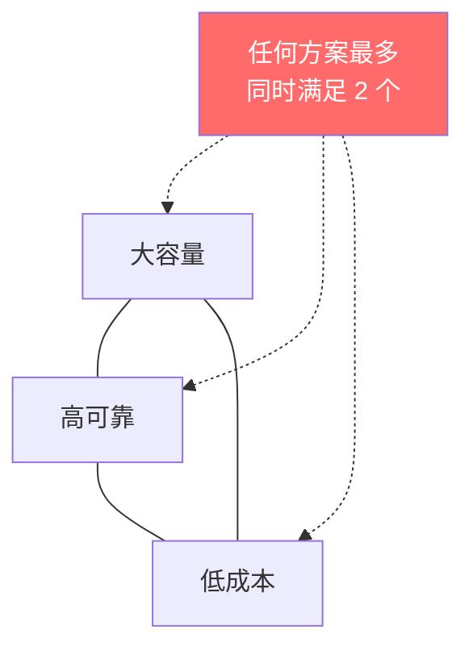
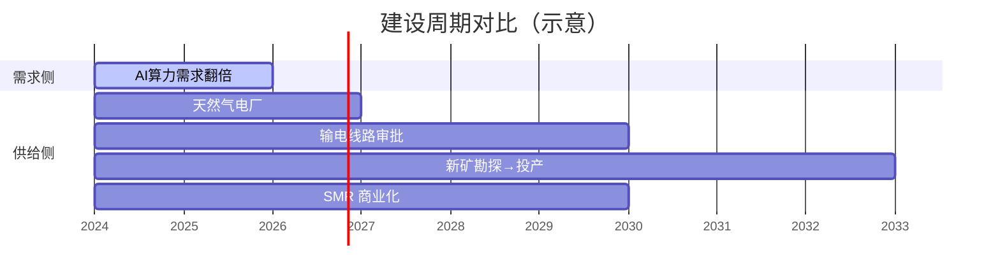
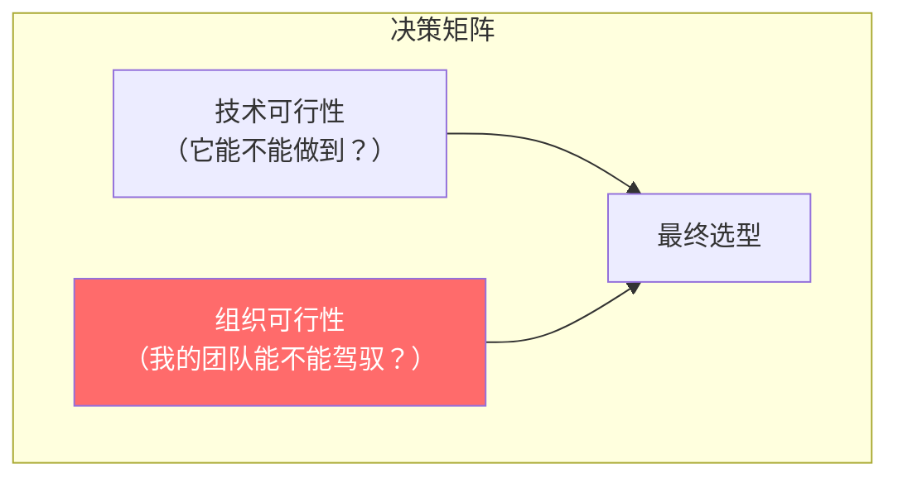
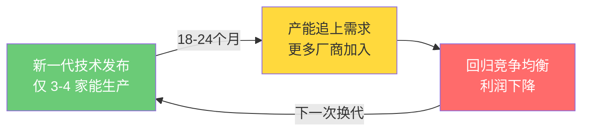
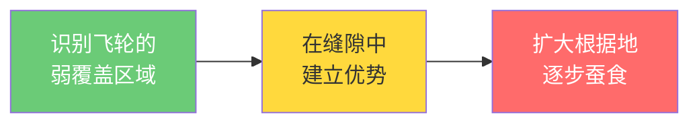
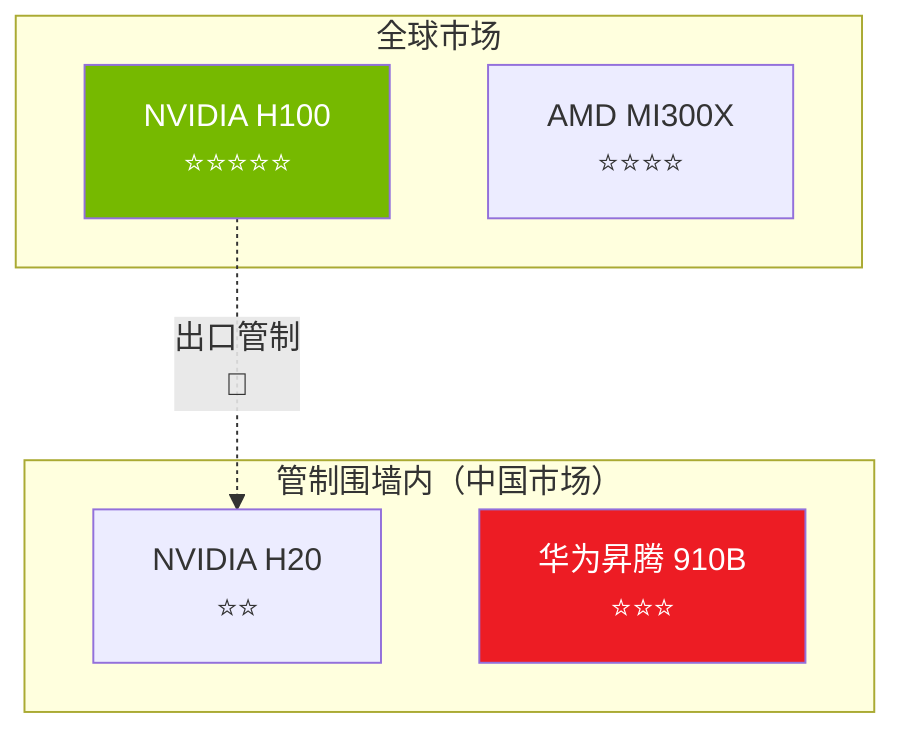
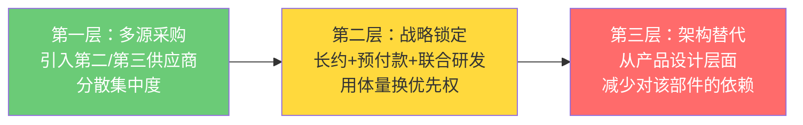

# 思维模型库

::: tip 使用说明
这里收录的是跨周次提炼出的**可复用分析框架**。每个模型标注来源周次，但其适用范围不限于来源周。
:::

## 模型 1：硬约束三角（Week 1）

分析任何基础设施方案时，检查三个维度是否同时满足：

**应用场景**：评估电力方案、数据中心选址、芯片供应商选择——凡是涉及"基础设施选型"的决策，先画出三角，标出每个方案能满足哪两个角。

## 模型 2：产能弹性 × 定价权矩阵（Week 1）

判断产业链某环节能否捕获超额利润：

|  | 产能弹性高 | 产能弹性低 |
|--|-----------|-----------|
| **定价权强** | 短期暴利，但竞争者快速涌入 | **持续超额利润**（理想位置） |
| **定价权弱** | 完全竞争，无超额利润 | 被上下游挤压，最惨 |

**应用场景**：分析任何产业链环节的投资价值。先问：它的产能扩张需要多久？它面对上下游有没有定价权？

## 模型 3：建设周期错配分析（Week 1）

当需求增长速度 >> 供给建设周期时，产生结构性短缺。

**应用场景**：任何"需求暴增但供给有物理约束"的场景。错配越大，中间环节的定价权越强。

---

## 模型 4：软件生态锁定 > 硬件锁定（Week 3）

评估竞争护城河的持久度时，区分两种锁定类型：

| | 硬件锁定 | 软件生态锁定 |
|--|---------|------------|
| **打破方式** | 买新设备（一次性动作） | 重写代码 + 重建社区（持续投入） |
| **成本类型** | 金钱 | 工程师-年 |
| **随时间变化** | 设备折旧 → 锁定减弱 | 生态积累 → 锁定加强 |
| **典型案例** | NVLink → AMD Infinity Fabric 可替代 | CUDA → ROCm 迁移成本极高 |

**应用场景**：分析任何平台/生态的护城河时，先区分"花钱能解决"和"花钱也解决不了"的锁定层。后者才是真正的长期壁垒。

## 模型 5：组织能力决定技术选型（Week 3）

同一个技术方案，对不同规模组织的可行性截然不同：

**应用场景**：评估技术方案时不只问"这个技术好不好"，还要问"这个技术需要多少人、什么水平的人来运维和调优"。Meta 选以太网替代 InfiniBand 成功（1,000+ 网络工程师），不代表 500 人创业公司也能做到。**"开箱即用"（Turnkey）方案在组织能力受限时价值极高。**

## 模型 6：技术代际窗口期（Week 3）

技术换代期存在 18-24 个月的溢价窗口：

**应用场景**：分析"看起来没有垄断但利润很高"的环节时，检查是否处于技术换代窗口期。典型案例：800G 光模块（2024-2025 仅少数厂商能做 → 短期超额利润 → 2026+ 产能追上 → 回归量大利薄）。投资时机比选公司更重要。

---

## 模型 7：缝隙战略——面对飞轮型垄断的进攻路径（Week 4）

面对已经转起来的飞轮（正反馈循环），正面硬刚几乎不可能成功。有效策略是**找到飞轮覆盖不到的缝隙**，在缝隙中建立根据地，再逐步扩大。

**应用场景**：AMD 挑战 NVIDIA 的最优策略不是追平 CUDA 生态（正面硬刚），而是专攻推理市场（CUDA 依赖弱、性价比敏感）。同理适用于任何挑战者 vs 生态型垄断的竞争分析——找对手不强的细分领域切入。

## 模型 8：先免费后付费的优化序列（Week 4）

面对效率/性能问题时，按投资回报率排序优化动作：

| 优先级 | 类型 | 成本 | 典型手段 |
|--------|------|------|---------|
| **1** | 软件优化（免费） | 零/低 | 算法改进、通信重叠、算子融合 |
| **2** | 配置优化（低成本） | 低 | 调参、调度策略、批次大小 |
| **3** | 硬件升级（高成本） | 高 | 换 GPU、升级 HBM、加网络带宽 |

**应用场景**：不只适用于 GPU 优化。任何效率问题的优化序列都应该先穷尽免费选项再花钱。类比策略运营：先把免费流量玩法做到极致，再投预算买付费流量。

## 模型 9：推理成本与 TAM 的正反馈（Week 4）

推理成本降低 → 更多场景的 Unit Economics 跑通 → 市场扩大 → 总调用量暴增 → 需求不降反增。

**应用场景**：评估技术进步的商业影响时，不只看存量市场的成本节省（零和），更要看它打开的**增量市场**（正和）。价格弹性越高的市场，成本降低带来的增量越大。

---

## 模型 10：垂直整合 vs 水平分工的决策（Week 5）

什么时候应该自研全栈（像 Google TPU），什么时候应该外购最佳组件（像大多数公司买 NVIDIA）？

| 条件 | 垂直整合（自研） | 水平分工（外购） |
|------|----------------|----------------|
| **规模** | 规模巨大，足以摊薄自研成本 | 规模不够大，自研 ROI 为负 |
| **供应链风险** | 供应商锁定是战略威胁 | 供应商竞争充分，风险可控 |
| **组织能力** | 有全栈工程能力 | 缺乏硬件/底层软件团队 |
| **典型案例** | Google TPU、Apple 自研芯片 | 大多数 AI 创业公司用 NVIDIA |

**应用场景**：自研 vs 外购决策。核心判断是**规模 × 组织能力**是否足以支撑自研的固定成本。与模型 5（组织能力决定技术选型）高度相关——垂直整合只有顶级组织能做到。

## 模型 11："卖产品" vs "卖服务"的商业模型选择（Week 5）

| 维度 | 卖产品（一次性销售） | 卖服务（经常性收入） |
|------|--------------------|--------------------|
| **毛利率** | 40-60% | 60-70% |
| **收入模式** | 一锤子买卖 | 按月/按量持续付费 |
| **客户锁定** | 弱——买完可以换 | 强——数据/代码/工作流迁移成本高 |
| **市场规模** | 更广（任何人可买） | 较窄（需要基础设施支撑） |
| **估值倍数** | 较低（P/E） | 较高（P/S，资本市场偏爱经常性收入） |

**应用场景**：任何"卖工具 vs 卖解决方案"的商业模式选择。Google 不卖 TPU 芯片而只卖云服务、Adobe 从卖软件转为订阅制、特斯拉从卖车到卖 FSD 订阅——都是从"卖产品"走向"卖服务"的案例。

## 模型 12：管制驱动的市场结构（Week 5）

出口管制、政策法规可以**人为创造市场边界**，改变竞争的参照系。

**应用场景**：分析任何受政策影响的市场时，先画出"围墙"在哪里，再在围墙内部做竞争分析。围墙内的竞争参照系与全球市场完全不同。适用于：中国 AI 芯片市场、欧盟数据市场（GDPR 边界）、医药市场（各国审批体系）。

---

## 模型 13：供应链风险的三层防御（Week 6）

面对关键供应商的依赖风险，按深度递进的三层防御：

**应用场景**：任何"单一关键供应商"风险。NVIDIA 对 SK Hynix 的 HBM 依赖、苹果对台积电的制造依赖、中国对进口芯片设备的依赖——都可以用这个三层框架分析。先分散、再锁定、最后从架构上减少依赖。

## 模型 14：定量验证直觉（Week 6）

在做战略判断前，先用简单算术验证直觉是否成立。

**经典陷阱**：看到"成本增加 30%"就直觉认为"不划算"，但如果同时"利用率提升 40%"，实际总成本可能反而下降。40% 利用率提升意味着需要的单元数减少 29%，抵消了 30% 的单价增加。

**应用场景**：任何涉及"多花一点钱换取效率提升"的决策——技术投资、人员扩编、设备升级——都应该先算一笔总账再做判断。数字会说话，直觉会骗人。

---

## 模型 15：非线性成本 → 非线性定价（Week 7）

当底层成本结构是非线性的（如 Attention 的 O(n²)），线性定价必然导致亏损或扭曲。

| 成本形状 | 定价策略 | 案例 |
|----------|---------|------|
| 线性（用量翻倍→成本翻倍） | 可以按量均价 | 传统带宽、存储 |
| 超线性（用量翻倍→成本翻四倍） | 必须分档/阶梯定价 | AI 长上下文、电力峰值 |
| 亚线性（用量翻倍→成本<翻倍） | 可以给量大客户折扣 | SaaS 座席费 |

**应用场景**：任何"用量越大、边际成本越高"的服务——AI API 长上下文附加费、电力峰谷定价、云计算突发计费。产品定价必须反映成本的**形状**，不仅仅是总量。

## 模型 16：一次性投入换可变节省——Break-even 思维（Week 7）

| 问题 | 计算 |
|------|------|
| 是否值得花更多固定成本换更低可变成本？ | 总调用量 × 单次节省 > 额外固定投入？ |
| 回本周期？ | 额外固定投入 ÷ 每日节省 = 天数 |
| 在产品生命期内能回本吗？ | 回本天数 < 预期运营天数？ |

**应用场景**：Chinchilla 最优 vs 推理最优（多花训练钱换推理省钱）、自建系统 vs 外包、预付年费 vs 按需付费、招全职 vs 外包。本质是经典的"固定成本 vs 可变成本"决策。

---

## 模型 17：并行方式的"切法"三分（Week 8）

> 分布式训练的三种并行本质是三种不同的"切法"：TP 切**矩阵内部**（层内并行）、PP 切**层与层之间**（层间并行）、DP 切**数据**（副本并行）。切的对象决定通信频率——切得越细，通信越频繁，越需要最快的互联。

**应用场景**：任何分布式系统的任务切分决策。先想清楚"切的是什么"，再决定用什么级别的互联/协调机制。

---

## 模型 18：迭代优势 vs 静态天花板（Week 8）

> 简单方案（DPO）依赖既有数据，效果有静态天花板；复杂方案（RLHF）能随反馈数据持续迭代，天花板会随规模扩大不断上移。

**应用场景**：技术选型中"简单够用 vs 为增长预留空间"的权衡——规则引擎 vs 机器学习模型、单体架构 vs 微服务。判断依据是：当前规模下静态天花板是否已经够用？

---

## 模型 19：延迟 vs 吞吐的不可兼得（Week 9）

| 场景类型 | 优化目标 | 类比 | 案例 |
|----------|---------|------|------|
| 交互式（聊天、搜索） | 延迟优先 | 出租车——随叫随走但效率低 | ChatGPT、客服 |
| 批处理（翻译、摘要） | 吞吐优先 | 公交车——装满才走但总量大 | 批量翻译、文档处理 |
| 极端吞吐 | 纯吞吐 | 货运列车——单件极慢但总量最大 | 离线数据处理 |

**应用场景**：任何服务系统的容量规划。先判断场景是延迟敏感还是吞吐敏感，再决定批处理粒度。强行兼得通常两头不讨好。

## 模型 20：帕累托前沿——精度与成本的边界（Week 9）

> 在"精度损失"和"成本节省"之间存在一条不可逾越的帕累托前沿：不存在"既更便宜又更精确"的方案。优化的目标是**找到当前场景可接受精度损失下的最便宜点**，而不是无脑压低精度。

| 精度档位 | 成本 | 精度 | 适用场景 |
|----------|------|------|----------|
| BF16 | 100% | 99%+ | 高质量交互 |
| INT8（甜点） | 25% | 97% | 主流推理 |
| INT4（极限） | 12.5% | 92% | 成本敏感 |

**应用场景**：任何"质量 vs 成本"的工程决策——量化、压缩、降级服务。关键是定义清楚"可接受的质量下限"，然后在前沿上选最优点。

---

## 模型 21：性能需求的三轴分解（Week 9 推演）

> 任何"要快"的需求都必须先拆成三个独立的轴——**延迟**（单请求多久有反应）、**吞吐**（单位时间总处理量）、**质量**（答得对不对）。三者不能互相代指，而且常常互相对冲：加大批次提吞吐会推高延迟，量化降成本会损质量。

"延迟"本身还要再拆：**TTFT**（首字延迟，由 prefill 阶段决定）和 **TPOT**（每 token 输出时间，由 decode 阶段决定）。优化手段各管一端——投机解码改善 TPOT，对 TTFT 无效。

**应用场景**：所有性能需求的澄清。听到"要快"、"要流畅"、"用户等不及"，第一反应不是去优化，是先问"快在哪个轴上"。

---

## 模型 22：降本红利的分配规律（Week 9 推演）

> 一个产业经历大幅降本时，受益最大的**不是成本结构中占比最大的环节**——那恰恰是降本的刀首先砍向的对象。受益最大的是**因成本下降而解锁了全新需求的下游**：它的变化是 0→1 的质变，上游只是边际量变。

同时要区分**绝对收入**与**相对地位**：杰文斯悖论（Jevons Paradox）下，单位成本下降会放大总消耗，上游绝对营收可能继续上涨，但议价能力在下降。**受损最大的永远不是被压缩的龙头，而是只赚价差、不创造增量价值的中间层。**

**应用场景**：任何技术降本周期的产业链判断。反向使用：想知道降本会从哪里挤出来，先看成本结构里谁占比最大。

---

## 模型 23：同一技术在不同位置的风险不对称（Week 9 推演）

> 一项有缺陷的技术，风险大小取决于它在系统中的**位置**，而不是缺陷本身有多大。蒸馏小模型有 20% 能力损失：放在**主模型**位置，这 20% 直接变成用户看到的错误；放在**草稿模型**位置（投机解码），猜错由大模型兜底，精度损失为零。

判断依据：**这个环节的输出有没有下游校验**。有校验，缺陷被吸收；没校验，缺陷直达用户。

**应用场景**：技术选型时"这个方案不够好所以不用"的草率否决。正确的问法是"它够好到能放在哪个位置"——便宜但不可靠的组件，放在有兜底的位置上就是免费的性能。

---

## 待补充

后续周次的新模型将持续添加。
