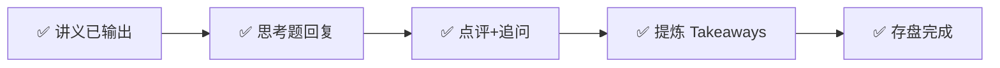

---
prev:
  text: '📖 讲义'
  link: '/week-07/lecture'
next:
  text: '✅ 认知存盘'
  link: '/week-07/takeaways'
---

# Week 7 · 互动记录

::: tip 状态
✅ 思考题点评完成
:::

## 交互流程

## 课堂追问

### Q：API 是什么意思？之前在哪里提到过？

**背景**：看 Week 7 讲义时忘记了 API 的含义。

**解答**：

**API = Application Programming Interface（应用程序编程接口）**

类比：**自动售货机的投币口**——你不需要知道内部怎么运转，只需按规定格式投入请求，就能拿到结果。

在 AI 语境中，"API 按 token 收费"= 公司把模型包装成服务，用户通过网络发送文本请求，按处理的 token 数量付费——就像打电话按分钟计费。

**历史出现位置**：
- Week 3 互动：Intel oneAPI（GPU 编程框架）
- Week 4 互动：推理成本 → API 定价逻辑（"GPT-4 API 调用 $0.03/次"）
- Week 5 互动：Groq 的推理 API 服务（GroqCloud）
- Week 7 讲义：Attention O(n²) → API 必须按 token 数收费

---

## 思考题点评

### 题目 1：Attention 的 O(n²) 与 API 定价策略（6.5/10）

**你的回答**：
> 公司需要在定价上有竞争力，按照分段的 session 来收费。设置不同的上下文 attention 边界对应不同的报价，对不同需求的用户有梯度定价的优势。

**点评**：

✅ 方向正确：
- 竞争格局判断好——头部集中→定价需要竞争力
- 梯度分段定价是行业主流做法
- "怎么划算怎么来"的商业直觉好

⚠️ 可以更深：题目提示对比"按 token 数" vs "按上下文长度"两种模式利弊，没有展开：

| 模式 | 优点 | 缺点 |
|------|------|------|
| **按 token 数** | 用多少付多少，对轻量用户友好 | 不反映 O(n²) 真实成本——100K 长对话的 Attention 计算量远超 100 条 1K 短对话，但按 token 总量收费一样 |
| **按上下文长度分档** | 反映真实成本结构 | 用户心智负担重，可能流失轻度用户 |

**最优解**：混合定价——基础按 token 计价（透明）+ 长上下文附加费（反映 O(n²)），默认低档（4K/8K），需要时升档。已知条件"用户通常不用满最大上下文"支持这个设计。

---

### 题目 2：Chinchilla 最优 vs 推理最优（5.5/10）

**你的回答**：
> 子项小模型一次性训练用 Chinchilla 最优（训练触发次数不多，一次性固定成本可控）。通用大模型持续迭代用推理最优（后续的持续推理是成本增加的变量）。

**点评**：

✅ 核心逻辑方向对了：选择取决于训练成本 vs 推理成本的比重

⚠️ 框架映射需要修正：

讲义里的区分不是"小模型 vs 大模型"，而是**调用量高 vs 低**：

| 场景 | 选择 | 原因 |
|------|------|------|
| 研究实验室 / 内部工具 / 调用量低（万次/天） | Chinchilla 最优 | 训练省钱，推理成本总额小不敏感 |
| 面向消费者 API / 调用量巨大（亿次/天） | 推理最优 | 训练多花 $5000 万（一次性），但推理每天省 $100 万 → 50 天回本 |

本质是**固定成本 vs 可变成本的 break-even 计算**——你做商业化时熟悉的"ROI 回本周期"逻辑。

---

### 题目 3：Scaling Law 天花板的投资含义（5/10）

**你的回答**：
> 天花板出现 → 从电力到 GPU 迭代到一定程度就够用了。内存带宽影响最小（当前是限制 GPU 的最大因素）。NVIDIA GPU 影响最大（使用率未满且升级不能带动模型迭代）。

**点评**：

✅ 大方向对：天花板 → 基础设施需求见顶

⚠️ 两个修正：

**修正 1**：Scaling Law ≠ 摩尔定律
- 摩尔定律 = 晶体管每 18 个月翻倍（硬件制造规律）
- Scaling Law = 模型性能随参数/数据/算力的幂律提升（AI 经验规律）
- 两者没有从属关系

**修正 2**：题目要求逐层分析"影响大小"和"是否有保底需求"：

| 层级 | 天花板影响 | 保底需求？ |
|------|-----------|-----------|
| 电力/数据中心（W1-2） | 中等 | ✅ 有——推理 24/7 运行，且推理总量随用户增长 |
| 互联网络（W3） | **最大** | ❌ 弱——万卡集群主要为训练而建，模型不再变大→不需更大集群 |
| GPU 硬件（W4） | 大 | 部分——需求从训练芯片转向推理芯片（更小、便宜、高能效） |
| 内存/HBM（W6） | 中等 | ✅ 有——存量模型推理仍需 KV Cache，你的判断对了 |

**关键洞察**：天花板出现时，产业重心从"训练军备竞赛"转向"推理效率竞赛"——受益方从 NVIDIA 变成推理芯片（Groq/Cerebras）、量化/蒸馏技术、应用层。

---

## 综合评分

| 题目 | 得分 | 评语 |
|------|------|------|
| Q1 定价策略 | 6.5/10 | 方向对，但没展开两种模式对比 |
| Q2 训练策略选择 | 5.5/10 | 核心逻辑对，框架映射有偏差 |
| Q3 投资含义 | 5/10 | 大方向对，逐层分析不够，混淆 Scaling Law 和摩尔定律 |

**整体进步点**：商业直觉是你的优势（竞争思维、固定/可变成本感觉）。需强化的是**把讲义里的具体数字/机制映射到商业判断**——如 Q1 的 1024 倍计算量差距直接决定定价必须非线性，Q3 要逐层回忆需求驱动力是训练还是推理。

---

## 新增思维框架

### 框架 15：非线性成本 → 非线性定价

> 当底层成本结构是非线性的（如 O(n²)），线性定价（按 token 均价）必然导致亏损或扭曲。产品定价必须反映成本的**形状**，不仅仅是**总量**。

**应用场景**：任何"用量越大、边际成本越高"的服务——云计算超额费、电力峰谷定价、AI 长上下文。

### 框架 16：一次性投入换可变节省（Break-even 思维）

> 当面临"花更多固定成本来降低单次可变成本"的选择时，决策取决于：总调用量 × 单次节省 > 额外固定投入？回本周期是否在产品生命期内？

**应用场景**：Chinchilla vs 推理最优、自建 vs 外包、预付 vs 按需。
