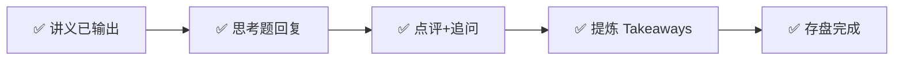

---
prev:
  text: '📖 讲义'
  link: '/week-08/lecture'
next:
  text: '✅ 认知存盘'
  link: '/week-08/takeaways'
---

# Week 8 · 互动记录

::: tip 状态
✅ 思考题点评完成
:::

## 交互流程

## 思考题点评

### 题目 1：3D 并行的工程决策（4/10）

**你的回答**：
> 512块 H100 GPU 约等于4万tb？200B的模型...TP张量并行可以负责精度要求较高的主参数存储，pp流水线并行或者DP都可以负责向前或向后传播，因为pp的传播会有通信浪费，而dp的传播涉及一次性同步时间较长

**点评**：

⚠️ **计算错误**：512 块 H100，每块 80GB 显存 = 512 × 80GB = **40,960 GB ≈ 41 TB**（不是 4 万 TB，GB 和 TB 差了 1000 倍）。

⚠️ **概念混淆**——TP/PP/DP 的角色分配理解有误：

| 并行方式 | 实际负责什么 | 你的理解 |
|---------|-------------|---------|
| TP（张量并行） | 把**同一层的矩阵切开**，分给多卡算 | ❌ "负责精度较高的主参数存储"——这是混合精度的概念，跟 TP 无关 |
| PP（流水线并行） | 把**不同层**分给不同卡，数据依次流过 | 部分对，但"负责向前向后传播"不准确——所有并行方式都要做前向反向 |
| DP（数据并行） | 每卡**完整模型副本**，处理不同数据，最后同步梯度 | 方向对，但没抓住核心是"复制模型"这件事 |

**正确设计思路**：512 卡 = 64 台 × 8 卡/台。TP 必须在机器内（≤8 卡，走 NVLink）：

- **TP = 8**（用满一台机器的 8 卡）
- 200B 模型经 TP=8 分担后，每卡负责 25B 参数，配合 ZeRO 基本装得下，不需要很深的 PP
- 合理配置：**TP=8, PP=4, DP=16**（8×4×16=512 ✓）——PP 进一步降低单卡内存压力，DP 提升训练吞吐

**决策逻辑**：先满足"TP 只能在机器内"的硬约束 → 再看模型是否装得下决定 PP 深度 → 剩下的卡分给 DP。

---

### 题目 2：RLHF vs DPO（6/10）

**你的回答**：
> 创业阶段选 DPO，能降低训练成本到1/3。3年后看是否有长期可持续发展趋势，若有则转RLHF，因为RLHF不会限定最优答案。

**点评**：

✅ 用成本占比做量化框架，思路对；结论方向正确（创业选 DPO，规模化后转 RLHF）

⚠️ **需要修正**：

1. 讲义中 GPT-4 训练总成本 $8000万-1.5亿、团队50-100人，这是**训练总成本**，不是对齐阶段单独成本——对齐阶段本身只占极小比例算力（约1%），但人力/标注成本占比不小。

2. **核心逻辑没抓住**：RLHF 的真正优势不是"不限定最优答案"，而是**奖励模型可以随着标注数据迭代变得越来越准，让 PPO 探索出训练数据里本来没有的更好答案**。DPO 直接锚定已有偏好对，天花板更低。

   3 年后规模变大意味着：① 能雇更多标注员持续喂养奖励模型 ② 有更大用户量收集海量真实反馈 ③ 竞争进入"体验精细化"阶段，DPO 天花板不够用。这才是"答案会变"的真正原因——不是"讲义有没有提到"，而是**规模扩大后 RLHF 的迭代优势才能发挥**。

---

### 题目 3：合成数据的验证边界（8/10，本周最佳）

**你的回答**：
> 可被验证的合成数据需要：能够通过已知的公理或者公式进行校验，并且存在推理或者计算的过程。不涉及情感个人判断，数理化相关的科学知识都可以被验证。

**点评**：

✅ 判断标准提炼准确——**可验证性 = 存在客观、可执行的检验机制**，不是"感觉对不对"

**补充具体例子**：

| 领域 | 验证方式 |
|------|---------|
| 逻辑推理题 | 用形式逻辑规则检查推导是否成立 |
| 结构化数据/SQL | 跑一遍查询看是否报错、结果是否符合 schema |
| 游戏/棋类对局 | 用规则引擎判断走法合法性、胜负 |
| 科学模拟 | 用已知定律或数值模拟验证结果一致性 |
| 单元测试驱动代码生成 | 生成代码+生成测试，两者互相验证 |

**延伸洞察**：正因为语言生成、创意写作、开放式问答没有唯一正确答案，这类合成数据难以自我验证，只能靠人类偏好（回到 RLHF/DPO）——这解释了为什么合成数据在数理领域突破快，在开放对话领域进展慢。

---

## 综合评分

| 题目 | 得分 | 核心问题 |
|------|------|---------|
| Q1 3D 并行设计 | 4/10 | TP/PP/DP 角色理解混淆，需重新梳理"谁负责切什么" |
| Q2 RLHF vs DPO | 6/10 | 量化框架对，但没抓住"规模化后 RLHF 迭代优势"的核心逻辑 |
| Q3 合成数据验证 | 8/10 | 判断标准提炼准确，是本周最佳答案 |

---

## 新增思维框架

### 框架 17：并行方式的"切法"三分

> 分布式训练的三种并行本质是三种不同的"切法"：TP 切**矩阵内部**（层内并行）、PP 切**层与层之间**（层间并行）、DP 切**数据**（副本并行）。切的对象决定了通信频率：切得越细（矩阵内部）通信越频繁，必须用最快的互联。

**应用场景**：任何分布式系统的任务切分决策——先想清楚"切的是什么"，再决定用什么级别的互联/协调机制。

### 框架 18：迭代优势 vs 静态天花板

> 简单方案（DPO）依赖既有数据，效果有静态天花板；复杂方案（RLHF）能随反馈数据持续迭代，天花板会随规模扩大不断上移。选择取决于：当前规模下静态天花板是否已经足够？还是需要为未来的迭代空间提前投资复杂度？

**应用场景**：技术选型中"简单够用 vs 为增长预留空间"的经典权衡——不仅是 RLHF vs DPO，也适用于规则引擎 vs 机器学习模型、单体架构 vs 微服务。
