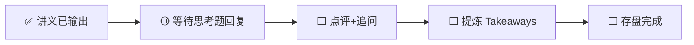

---
prev:
  text: '📖 讲义'
  link: '/week-08/lecture'
next:
  text: '✅ 认知存盘'
  link: '/week-08/takeaways'
---

# Week 8 · 互动记录

::: info 状态
🟡 等待思考题推演回复
:::

## 交互流程

## 思考题回顾

### 题目 1：3D 并行的工程决策
> 512 块 H100（64 台服务器）训练 200B 模型，如何设计 TP×PP×DP？

**你的回答**：（待填写）

**点评与补充**：（待填写）

---

### 题目 2：RLHF vs DPO 的战略选择
> 创业公司不同阶段（$2000 万 vs $2 亿）如何选择对齐方法？

**你的回答**：（待填写）

**点评与补充**：（待填写）

---

### 题目 3：合成数据的"信任边界"
> 除了数学和代码，哪些领域的合成数据可以被验证？

**你的回答**：（待填写）

**点评与补充**：（待填写）

---

## 追问与延伸讨论

（互动过程中产生的追问将记录在此）
