---
prev:
  text: 'Week 7 · Transformer'
  link: '/week-07/lecture'
next:
  text: '💬 互动记录'
  link: '/week-08/interaction'
---

# Week 8 · 训练工程

::: tip 本周定位
Week 7 讲了 Transformer **是什么**和 Scaling Law **为什么有效**。本周回答一个工程问题：**怎么把一个 1000 亿参数的模型，用 1 万块 GPU 在 3 个月内训练出来？** 这不是理论问题——它是一个涉及分布式系统、数据工程、算法对齐、故障恢复的综合工程挑战。
:::

---

## 一、训练的本质：一个巨大的迭代循环

### 1.1 训练 = 反复调参数

把 LLM 训练想象成一个**超大规模的"猜答案游戏"**：

1. 给模型看一句话的前半段："今天天气"
2. 模型猜下一个字："好"（概率 30%）、"很"（概率 25%）、"不"（概率 15%）...
3. 正确答案是"很" → 计算猜错的程度（Loss）
4. 根据猜错程度，**微调所有参数**让下次猜得更准
5. 重复以上过程 **数万亿次**

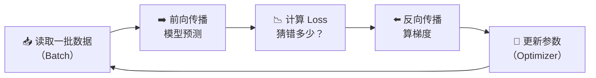

### 1.2 为什么训练这么难？

| 挑战 | 数字 | 类比 |
|------|------|------|
| 参数量 | 700 亿 - 1.8 万亿 | 要同时调整 7000 亿个旋钮 |
| 数据量 | 10-15 万亿 token | 相当于一个人不眠不休读 15 万年的书 |
| 计算量 | 10²⁴ - 10²⁵ FLOPS | 一块 H100 单独跑需要 300 年 |
| 时间约束 | 2-4 个月内完成 | 竞争对手也在训练，慢就是输 |
| 硬件故障 | 万卡集群每天 2-5 块 GPU 故障 | 马拉松跑步途中鞋子不断坏 |

**核心矛盾**：单块 GPU 太慢 → 必须用 1 万+ 块 GPU 并行 → 但并行带来通信开销、同步问题、故障频率。

**训练工程**就是解决这个核心矛盾的学科。

---

## 二、3D 并行：把大象装进冰箱的三种方式

Week 3 我们从网络拓扑角度介绍了 3D 并行。本周从**工程决策**角度深入：每种并行为什么存在？什么时候用？怎么组合？

### 2.1 数据并行（Data Parallelism, DP）

**核心思想**：每块 GPU 持有模型的**完整副本**，但各自处理不同的数据。

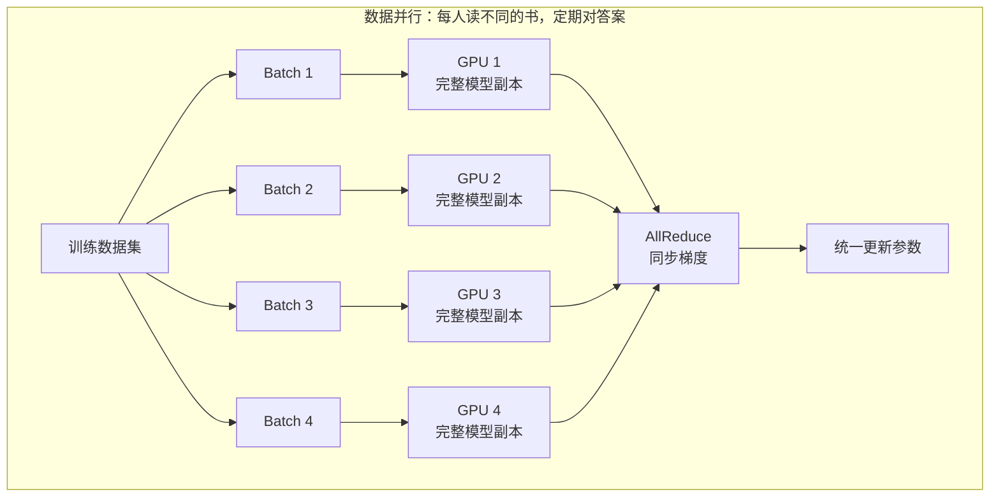

**类比**：4 个学生各读不同章节的同一本教材，每章读完后**对答案**（AllReduce），确保所有人的理解保持一致。

| 维度 | 特点 |
|------|------|
| 优点 | 实现最简单、扩展性好（加 GPU 就行）、通信频率低（每步一次 AllReduce） |
| 缺点 | 每块 GPU 必须装下完整模型。700B 参数 × 混合精度 ≈ **每 GPU 需 2.8TB 内存**——H100 只有 80GB |
| 适用 | 模型小到单卡能装下时（如 7B 以下） |

**FSDP / ZeRO 优化**：把模型参数、梯度、优化器状态**分片**存储到不同 GPU，需要时再临时凑齐。本质是"用通信换内存"。

### 2.2 张量并行（Tensor Parallelism, TP）

**核心思想**：把模型每一层的**矩阵切开**，分给多块 GPU，每个算子的计算结果拼起来。

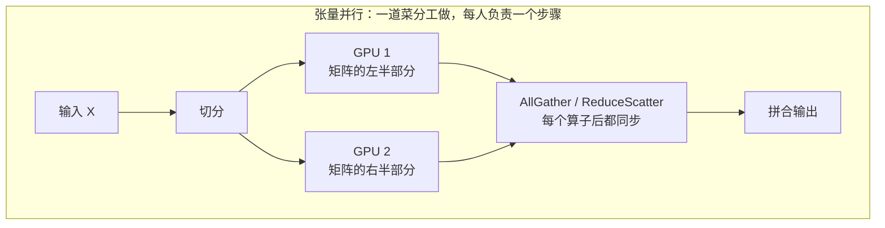

**类比**：两个厨师做一道菜——一个切菜一个炒菜，但每个步骤都要**递东西**（通信），所以必须站得很近（同一台机器内，走 NVLink）。

| 维度 | 特点 |
|------|------|
| 优点 | 能训练单卡装不下的大模型，延迟低（并行度高） |
| 缺点 | **通信极其频繁**——每个算子执行后都要同步。必须走 NVLink（900 GB/s），以太网根本不行 |
| 适用 | 同一台服务器内的 8 块 GPU（NVLink 互联）。典型 TP=8 |

### 2.3 流水线并行（Pipeline Parallelism, PP）

**核心思想**：把模型的不同**层**分到不同 GPU，数据像流水线一样依次流过。

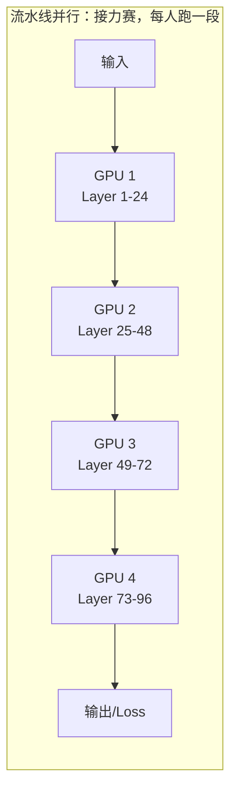

**类比**：工厂流水线——第一站组装底盘，第二站装引擎，第三站喷漆。每站只做自己那部分，做完传给下一站。

| 维度 | 特点 |
|------|------|
| 优点 | 通信量小（只传相邻层的激活值），可跨机器（以太网也够用） |
| 缺点 | **流水线气泡**（Pipeline Bubble）——前面的 GPU 在等后面算完，存在空闲时间 |
| 适用 | 跨服务器之间（通过以太网/InfiniBand 连接）。PP=4-16 |

**气泡问题**：

```
时间轴 →
GPU 1: [计算][等待][等待][等待][计算][等待]...
GPU 2: [等待][计算][等待][等待][等待][计算]...
GPU 3: [等待][等待][计算][等待][等待][等待]...
GPU 4: [等待][等待][等待][计算][等待][等待]...
                              ↑
                         气泡（浪费）
```

**解决方案**：微批次（Micro-batch）——把一个大 Batch 切成多个小 Batch，连续送入流水线，减少空闲。

### 2.4 3D 并行的组合：为什么叫"3D"？

实际训练时，三种并行**同时使用**，形成三维结构：

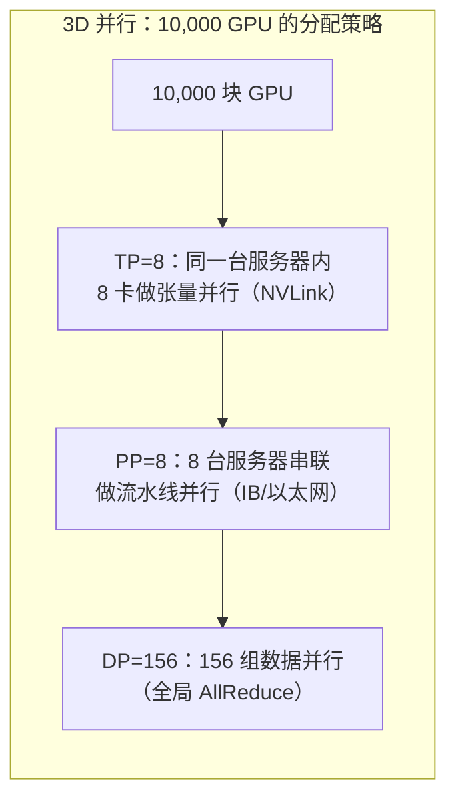

**数学验证**：TP × PP × DP = 8 × 8 × 156 = 9,984 ≈ 10,000 块 GPU ✓

| 并行方式 | 放在哪里 | 用什么互联 | 原因 |
|----------|---------|-----------|------|
| 张量并行（TP=8） | 机器内 | NVLink 900 GB/s | 每个算子都要同步→需要最快的互联 |
| 流水线并行（PP=8） | 机器间（同一 Pod） | InfiniBand/以太网 | 只传激活值→带宽需求中等 |
| 数据并行（DP=156） | 全集群 | InfiniBand/以太网 | 每步结束后全局同步→频率低但数据量大 |

> **Week 3 回溯**：当时讲的"把不同并行方式匹配到不同网络层次"，就是这个决策。NVLink 承载 TP，InfiniBand 承载 PP 和 DP。

---

## 三、混合精度训练：在精度和速度之间走钢丝

### 3.1 为什么不全用 FP32？

- FP32（32 位浮点）精度最高，但内存占用大、计算慢
- 一个 700B 模型，纯 FP32 需要 2.8 TB 内存存参数 + 梯度 + 优化器状态 ≈ **16.8 TB**
- 没有任何单台服务器有这么多内存

### 3.2 混合精度的"三明治"策略

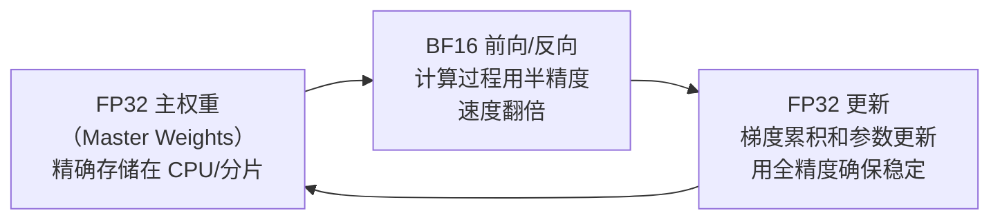

| 精度 | 用在哪 | 为什么 |
|------|--------|--------|
| FP32（32 位） | 主参数存储、参数更新 | 累积微小梯度需要高精度，否则"小水滴被四舍五入掉" |
| BF16（16 位） | 前向传播、反向传播 | Week 4 讲过：BF16 保留了 FP32 的指数范围，Tensor Core 原生支持 |
| FP8（8 位） | Blackwell 新架构支持 | Transformer Engine 自动在 FP8/BF16 间切换，速度再翻倍 |

**类比**：记账时用精确的小数点后四位（FP32），但日常口算时只保留整数和个位（BF16）——重要的数字用高精度保存，过程计算用低精度加速。

### 3.3 训练内存占用：一个 70B 模型需要多少 GPU？

| 组成部分 | 精度 | 大小 | 说明 |
|----------|------|------|------|
| 模型参数 | BF16 | 140 GB | 70B × 2 bytes |
| 梯度 | BF16 | 140 GB | 与参数同大 |
| 优化器状态（Adam） | FP32 | 560 GB | 2 个动量 × 70B × 4 bytes |
| 激活值（Activation） | BF16 | 200-400 GB | 取决于序列长度和 Batch 大小 |
| **总计** | — | **~1 TB+** | H100 80GB → 至少需要 **16 块 GPU** |

这就是为什么即使是 70B 的"小"模型，也必须用分布式训练。

---

## 四、梯度检查点：用时间换内存

### 4.1 问题：激活值太占内存

前向传播时，每一层的中间结果（激活值，Activation）需要保存——因为反向传播计算梯度时要用到它们。

一个 96 层的模型 = 保存 96 层中间结果 = 巨大的内存开销。

### 4.2 解决方案：选择性保存

**梯度检查点（Gradient Checkpointing / Activation Recomputation）**：只保存**部分层**的激活值，其他层在反向传播时**重新计算一遍**。

```
正常模式：保存所有激活值
Layer 1 → [保存] → Layer 2 → [保存] → ... → Layer 96 → [保存]
内存：极大    时间：最快

检查点模式：每隔 N 层保存一次
Layer 1 → [保存] → Layer 2 → [丢弃] → ... → Layer 8 → [保存] → ...
内存：减少 60-70%    时间：多花约 30%（因为要重算）
```

**类比**：读书时不是每页都做笔记（太慢），而是每章做一个标记。需要回顾某一页时，从最近的标记重新翻阅几页——牺牲一点时间，省下大量笔记本。

---

## 五、数据工程：训练的"原材料"决定产品质量

### 5.1 数据比模型更重要

Scaling Law 说性能取决于 N（参数）× D（数据）× C（算力），但实践证明：**数据质量的边际效果远高于数据数量**。

> "Garbage in, garbage out"——用低质量数据训练出的模型就像用地沟油做的菜，量再大也不行。

### 5.2 数据管线全流程

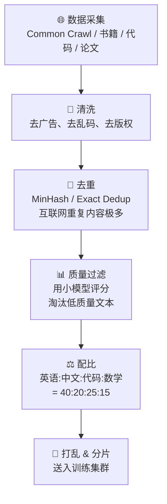

### 5.3 数据质量 vs 数量的关键发现

| 发现 | 来源 | 含义 |
|------|------|------|
| 同样的 7B 模型，用精选 1.4T token 训练 > 用全量 15T token | Phi 系列论文 | 质量 > 数量 |
| 去重后模型收敛更快，最终效果更好 | Llama 技术报告 | 重复数据有害 |
| 代码数据可以提升逻辑推理能力 | 多项研究 | 数据类型间有迁移效果 |
| 数据配比对最终能力有决定性影响 | Scaling Law 研究 | 不是均匀混合最优 |

### 5.4 数据配比的艺术

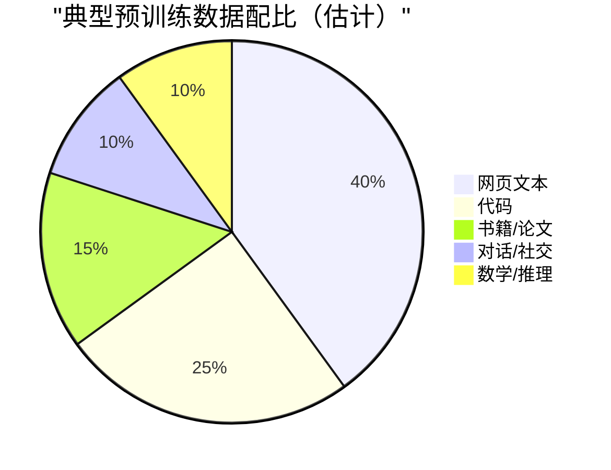

**为什么代码比例这么高？** 代码有严格的逻辑结构（if-then-else），训练时相当于在教模型**逻辑推理**。这就是为什么 GPT-4 的推理能力远强于纯文本训练的模型。

---

## 六、合成数据：当真实数据不够用

### 6.1 真实数据的天花板

Week 7 讲过：互联网高质量文本总量估计 5-15T token。当前最大模型已经在接近这个上限。

**问题**：Scaling Law 说"更多数据 = 更好"，但真实数据快用完了。怎么办？

### 6.2 合成数据的三种方式

| 方式 | 原理 | 类比 | 质量 |
|------|------|------|------|
| **自我蒸馏** | 用大模型生成数据来训练小模型 | 老师出模拟题给学生练 | 中高 |
| **改写增强** | 把同一内容用不同方式重述 | 同一道数学题换个数字 | 中 |
| **推理链生成** | 让模型生成"思考过程"（Chain of Thought） | 不仅要答案，还要写解题步骤 | 高 |

### 6.3 合成数据的天花板："模型崩塌"

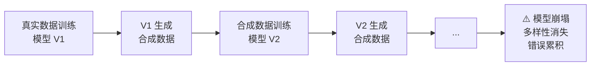

**Model Collapse（模型崩塌）**：用模型自己生成的数据反复训练自己，就像反复复印一份文件——每次都会丢失信息，最终变成模糊不可读。

**当前共识**：
- 合成数据能补充真实数据的不足（尤其是数学/代码/推理方向）
- 但不能完全替代真实数据
- 最优策略是**真实数据为主 + 合成数据补短板**
- 高质量合成数据的关键是**验证**——数学可以验证对错，代码可以跑通测试

---

## 七、从预训练到对齐：三个阶段

### 7.1 训练的三阶段

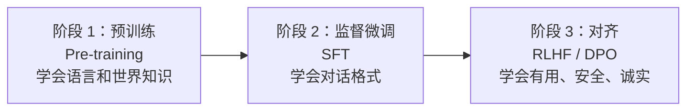

| 阶段 | 数据量 | 计算量占比 | 目标 |
|------|--------|-----------|------|
| 预训练（Pre-training） | 10-15T tokens | **99%** | 学习语言规律和世界知识 |
| 监督微调（SFT） | 10 万 - 100 万条对话 | ~0.5% | 学习"问→答"的对话格式 |
| 对齐（Alignment） | 数万条偏好对比 | ~0.5% | 学习人类偏好（有用、安全、不胡说） |

> **关键比例**：预训练占了 99% 的计算量，但对齐阶段决定了用户体验的 90%。这就像一个人学了 20 年知识（预训练），但最后入职前 1 周的培训（SFT+对齐）决定了他工作表现的观感。

### 7.2 监督微调（SFT）：教模型"说人话"

预训练后的模型像一本百科全书——什么都知道，但你问它问题，它可能会接着你的话继续写，而不是"回答"你。

**SFT 的作用**：用高质量的 `（指令, 回复）` 对话数据，教会模型"当用户问 X 时，应该回答 Y"的格式。

| 输入格式 | 模型学到的 |
|----------|-----------|
| `用户: 解释量子力学` → `助手: 量子力学是...` | 遇到问题要给出解释 |
| `用户: 帮我写一段代码` → `助手: ```python...` | 遇到代码请求要给代码 |
| `用户: 总结这篇文章` → `助手: 本文主要讨论了...` | 遇到总结请求要概括 |

### 7.3 RLHF：用人类偏好训练"品味"

**RLHF = Reinforcement Learning from Human Feedback（人类反馈强化学习）**

**为什么需要？** SFT 教会了格式，但没有教"好坏"。两个回答都格式正确，但一个更有帮助、更安全——怎么让模型学会区分？

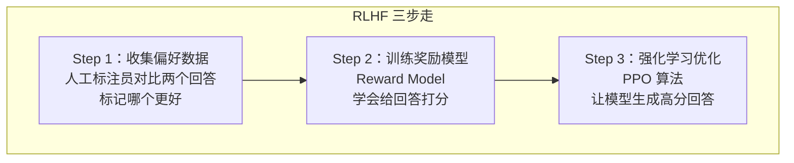

**详细流程**：

1. **收集偏好**：给同一个问题，让模型生成两个回答 A 和 B，人工标注员判断"A 比 B 好"
2. **训练奖励模型（Reward Model）**：一个独立的神经网络，学会模仿人类标注员的判断——给任何回答打分
3. **PPO 优化**：用强化学习（PPO 算法）调整模型参数，使其生成"奖励模型给高分"的回答

**类比**：
- 预训练 = 学生读了所有教材（有知识）
- SFT = 学生学会了考试的答题格式
- RLHF = 请了一个**评委（奖励模型）**，学生反复练习直到评委满意

### 7.4 DPO：RLHF 的简化版

**DPO = Direct Preference Optimization（直接偏好优化）**

**RLHF 的问题**：
- 需要单独训练一个奖励模型 → 额外的计算成本和复杂度
- PPO 算法不稳定，超参数敏感，训练容易崩
- 整个流程有 3 个模型在交互：策略模型、奖励模型、参考模型

**DPO 的解决方案**：跳过奖励模型，直接用偏好数据优化模型。

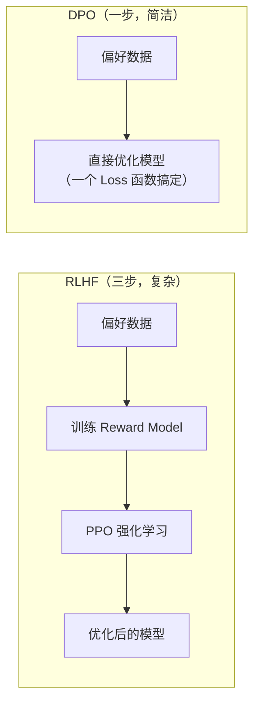

| 对比 | RLHF | DPO |
|------|------|-----|
| 步骤 | 3 步（偏好→RM→PPO） | 1 步（偏好→直接优化） |
| 复杂度 | 高（3 个模型协同） | 低（1 个 Loss 函数） |
| 稳定性 | PPO 容易崩，需要调参 | 稳定，类似标准微调 |
| 效果 | 理论上限更高（奖励模型能泛化） | 多数任务已接近 RLHF |
| 计算成本 | 高（奖励模型+PPO 都要 GPU） | 低（约 RLHF 的 1/3） |
| 当前趋势 | 头部公司仍在用（OpenAI/Anthropic） | 中小公司和开源社区首选 |

**为什么头部公司仍用 RLHF？**
- 奖励模型可以**迭代数据**——标注员产出偏好对，RM 越来越准，模型越来越好
- RLHF 的 PPO 能探索出训练数据中**没有的好回答**
- DPO 被限制在已有偏好对的"好答案上限"

---

## 八、训练基础设施：万卡集群的"运维地狱"

### 8.1 故障是常态，不是例外

| 集群规模 | 单 GPU 年故障率 | 预期每天故障数 |
|----------|----------------|---------------|
| 1,000 GPU | ~3% | ~0.1 次/天 |
| 10,000 GPU | ~3% | **~1 次/天** |
| 100,000 GPU | ~3% | **~8 次/天** |

一次训练跑 90 天 × 每天 1 次故障 = **90 次中断**。如果每次中断从头来，训练永远完不成。

### 8.2 检查点（Checkpointing）：训练的"存档点"

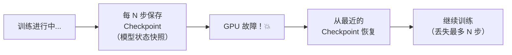

**Checkpoint 包含**：
- 所有模型参数（BF16/FP32）
- 优化器状态（Adam 动量）
- 学习率调度器状态
- 数据读取位置
- 随机数种子

**一次 Checkpoint 的大小**：700B 模型 ≈ **2-5 TB**

**保存频率的权衡**：
- 太频繁（每 10 步）：保存本身耗时，且占用大量存储
- 太稀疏（每 10,000 步）：故障时丢失的计算太多
- 典型选择：**每 100-500 步**保存一次

### 8.3 训练集群的软件栈

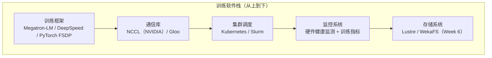

| 框架 | 开发者 | 特点 |
|------|--------|------|
| **Megatron-LM** | NVIDIA | 3D 并行原生支持，万卡训练首选 |
| **DeepSpeed** | Microsoft | ZeRO 优化，内存效率高 |
| **PyTorch FSDP** | Meta | 原生集成 PyTorch，使用门槛低 |
| **JAX/XLA** | Google | TPU 原生，函数式编程范式 |

### 8.4 训练时间线：一个 GPT-4 级别模型的诞生

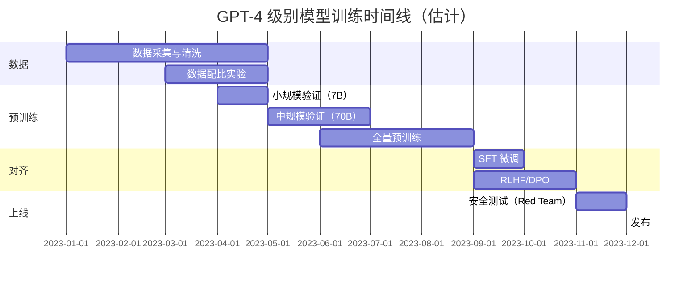

**预训练 3 个月** = 万卡集群 24/7 不间断运行 = 电费约 $500 万 - $2000 万

---

## 九、训练的经济学

### 9.1 训练成本构成

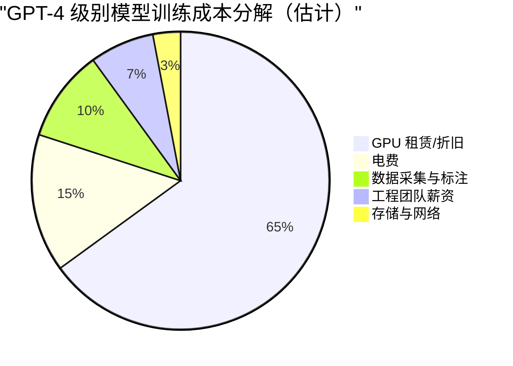

| 项目 | 估计金额 | 说明 |
|------|----------|------|
| GPU 算力 | $6000 万 - $1 亿 | 1 万块 H100 × 3 个月 × $2-3/GPU·小时 |
| 电费 | $1000 万 - $2000 万 | 20MW × 90 天 × $0.05-0.08/kWh |
| 数据 | $500 万 - $1000 万 | 标注员、数据购买、清洗流水线 |
| 人力 | $300 万 - $500 万 | 50-100 人团队 × 12 个月 |
| **总计** | **$8000 万 - $1.5 亿** | 2024 年一次 frontier 模型训练 |

### 9.2 训练成本的 Scaling

| 模型 | 年份 | 估计训练成本 |
|------|------|-------------|
| GPT-3（175B） | 2020 | $500 万 - $1000 万 |
| GPT-4 | 2023 | $8000 万 - $1 亿 |
| GPT-5（推测） | 2025 | $3 亿 - $5 亿 |
| 下一代 frontier | 2026-27 | $10 亿+ |

**每代模型训练成本增长 3-5 倍**，这就是为什么只有极少数公司能参与 frontier 模型训练——这是一场"烧钱军备竞赛"。

### 9.3 谁在投资训练？

| 玩家 | 策略 | 年训练投入（估计） |
|------|------|-------------------|
| **OpenAI** | 闭源 frontier，API 变现 | $30 亿+（含推理） |
| **Google** | 自研 TPU 降本，内部+云服务 | $20 亿+ |
| **Meta** | 开源 Llama，吸引生态 | $15 亿+ |
| **Anthropic** | 安全优先，高 RLHF 投入 | $10 亿+ |
| **中国头部** | 国产化替代（昇腾训练） | $5 亿+（受限于芯片获取） |

---

## 十、商业洞察：谁在训练工程中赚钱？

### 10.1 产业链价值分布

| 环节 | 代表公司 | 护城河 | 投资评级 |
|------|----------|--------|----------|
| **训练框架** | NVIDIA（Megatron）、Microsoft（DeepSpeed） | 开源，护城河弱 | ⭐⭐ 引流工具，不直接赚钱 |
| **训练芯片** | NVIDIA、Google（TPU） | 极深（Week 4-5 已分析） | ⭐⭐⭐⭐⭐ |
| **数据服务** | Scale AI、Appen、标注工厂 | 中等（人力密集） | ⭐⭐⭐ 需求确定但天花板低 |
| **训练集群租赁** | CoreWeave、Lambda Labs | 中（靠 GPU 供给关系） | ⭐⭐⭐⭐ 短期需求强劲 |
| **对齐技术** | Anthropic、OpenAI 内部 | 高（核心竞争力之一） | 未上市，难投 |

### 10.2 关键商业判断

1. **训练成本在未来 3 年会继续指数增长**——这强化了 Week 1-6 所有基础设施层的需求
2. **数据标注正在从人力密集转向 AI 辅助**——Scale AI 的商业模型面临变革
3. **对齐技术是模型公司的核心壁垒之一**——但很难独立投资（深度绑定在模型公司内部）
4. **训练和推理的计算需求比约为 1:3 到 1:10**——推理正在超过训练成为算力需求主体（Week 9 会深入）

---

## 十一、本周小结

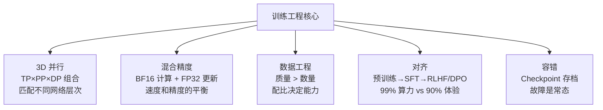

**一句话总结**：训练工程的本质是**在有限时间内，把 1 万块不可靠的 GPU 协调成一台可靠的超级计算机**，同时在精度、速度、内存三者之间不断走钢丝。

---

## 十二、思考题

::: warning 🧠 本周推演题（完成后解锁 Week 9）

**题目 1：3D 并行的工程决策**

已知条件（从讲义可推导）：
- 张量并行通信最频繁，必须走 NVLink（机器内，最多 8 卡）
- 流水线并行有"气泡"浪费，但通信需求低
- 数据并行最简单，但需要每块 GPU 能装下模型（或用 ZeRO 分片）

问题：假设你要训练一个 200B 参数模型，有 512 块 H100 GPU（64 台服务器，每台 8 卡）。你会如何设计 TP×PP×DP 的组合？请说明理由。

**题目 2：RLHF vs DPO 的战略选择**

已知条件：
- RLHF 复杂但理论上限高，DPO 简单但受限于已有偏好数据
- 头部公司仍在用 RLHF，中小公司和开源社区首选 DPO

问题：如果你是一家 AI 创业公司的 CTO，年预算 $2000 万，团队 30 人，你会选择 RLHF 还是 DPO？如果 3 年后公司发展到年预算 $2 亿、团队 300 人，答案会变吗？

**题目 3：合成数据的"信任边界"**

已知条件：
- 合成数据能补充真实数据的不足
- 但"模型崩塌"意味着不能无限自我生成
- 数学和代码的合成数据因为可以验证对错，质量上限更高

问题：除了数学和代码，你能想到还有哪些领域的合成数据可以被"验证"？（提示：什么类型的知识有客观标准可以判断对错？）

:::
