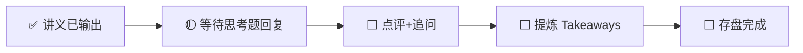

---
prev:
  text: '📖 讲义'
  link: '/week-09/lecture'
next:
  text: '✅ 认知存盘'
  link: '/week-09/takeaways'
---

# Week 9 · 互动记录

::: info 状态
🟡 等待思考题推演回复
:::

## 交互流程

## 思考题回顾

### 题目 1：推理优化的组合决策
> 电商 AI 客服，日均 100 万次对话，延迟 < 1 秒，选哪些优化技术组合？

**你的回答**：（待填写）

**点评与补充**：（待填写）

---

### 题目 2：推理成本与商业化可行性
> $100 万/年成本上限下，GPT-4 API / Llama 3 自部署 / 蒸馏小模型分别是否可行？

**你的回答**：（待填写）

**点评与补充**：（待填写）

---

### 题目 3：推理时代的赢家转移
> 推理成本再降 10 倍，哪层受益最大？哪层受损最大？

**你的回答**：（待填写）

**点评与补充**：（待填写）

---

## 追问与延伸讨论

（互动过程中产生的追问将记录在此）
