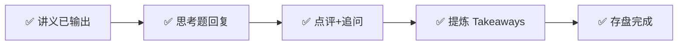

---
prev:
  text: '📖 讲义'
  link: '/week-09/lecture'
next:
  text: '✅ 认知存盘'
  link: '/week-09/takeaways'
---

# Week 9 · 互动记录

::: tip 状态
✅ 思考题点评完成
:::

## 交互流程

## 思考题点评

### 题目 1：推理优化的组合决策（7/10）

**你的回答**：
> 日均 100 万次对话，每次约 2000 token，相当于需要消耗 100万×2000=20 亿 token 日均，于是单次的推理成本决定了公司是否能承担的起。所以能够优化推理的有三个大方向：降低精度（量化）+ 降低内存 + 降低计算（蒸馏）。我会选择 INT8 来进行量化 + PagedAttention 降低内存 + 投机解码降低计算的组合。为什么不选蒸馏，因为整体对于响应的要求很高，蒸馏小模型会导致反映下降。

**点评**：

✅ **技术组合选对了**。INT8 + PagedAttention + 投机解码（Speculative Decoding）正好命中讲义 §7.1 的两个甜点区——"交互式高质量服务 → INT8 + GQA + PagedAttention" 再叠加"极致延迟 → 投机解码"。日均 20 亿 token 的量级算得也对。

✅ **用"三个优化方向"做框架**，而不是逐个技术罗列，说明抓到了分类轴。

⚠️ **漏了 GQA**。讲义 §7.2 的组合案例是四项叠加，GQA 把 KV Cache 缩小 4-8 倍，是**架构层面**的，现代模型（Llama 3 系列）出厂自带——它不需要你额外做工作，但必须出现在成本测算里，否则你会低估自己的吞吐。

⚠️ **不选蒸馏的理由站不住**。"蒸馏小模型会导致反映下降"——如果"反映"指**响应速度**，那结论是反的：蒸馏小模型参数更少、计算更少，**延迟只会更低不会更高**。真正该说的理由是讲义给的那个：**能力下降约 20%**。电商客服要处理订单状态、退款规则、优惠券叠加逻辑，答错有真实的赔付成本，20% 的能力缺口落在长尾问题上，正是最容易出事的地方。

把"快不快"和"行不行"混在一起说，是这道题最关键的概念滑坡。

---

**三个延伸追问**（这三点讲义没直接给，需要推一步）：

**① 你"不选蒸馏"和"选投机解码"在技术上是矛盾的。**

投机解码的机制是"小模型打草稿、大模型审核"。那个草稿模型从哪来？**通常就是蒸馏出来的**。所以准确的表述不是"不用蒸馏"，而是：

> 不把蒸馏模型作为**主模型**（能力不够），但用它作为**草稿模型**（只要猜得八成对就能省算力，猜错由大模型兜底，精度零损失）。

同一项技术放在不同位置，风险完全不同——放主模型要承担 20% 能力损失，放草稿模型则被大模型的验证环节完全对冲掉了。

**② PagedAttention 和你的延迟目标是对冲关系。**

PagedAttention 提升的是**吞吐**，机制是消除 KV Cache 内存碎片 → 显存里能塞下更多并发请求 → 批次（batch）更大。但批次越大，单个请求排队和计算的时间越长，**单请求延迟反而上升**。

这正是讲义 §2.2 出租车 vs 公交车的权衡在工程参数上的具体体现。实际部署要设 `max_batch_size` 上限：吞吐吃到够用为止，剩下的显存留给延迟。不是"开到最大"。

**③ "延迟 < 1 秒"只能是 TTFT，不可能是端到端。**

算一下：讲义 §5.2 给的是单 GPU INT8 约 100 token/秒。输出哪怕只有 500 token，生成完也要 5 秒；2000 token 要 20 秒。**端到端 1 秒在物理上不成立**。

所以这个需求只能理解为 **TTFT（Time To First Token，首字延迟）< 1 秒**——用户看到光标开始吐字就不焦虑了，后面流式输出慢慢来。

这个区分决定了你优化的是哪一端：TTFT 由 prefill 阶段（处理输入的 2000 token）决定，TPOT（每 token 输出时间）才由 decode 阶段决定。**投机解码优化的是 TPOT，对 TTFT 几乎没帮助**。如果真正的瓶颈是 TTFT，该上的是 prefill 阶段的优化（chunked prefill、prefix caching——命中同一套客服提示词时可以直接复用 KV Cache）。

---

### 题目 2：推理成本与商业化可行性（7.5/10）

**你的回答**：
> 首先计算标杆 GPT-4：100 万调用 × $0.06/次 = $6 万/天（$2190 万/年），Llama 3 自部署：100 万调用 × $0.002/次 = $2000/天（$73 万/年），蒸馏小模型：100 万调用 × $0.0005/次 = $500/天（$18 万/年）。企业能接受 $100 万一年的情况下，可以选择 Llama 自部署，这样在反映时间损失可接受的情况下，满足企业的预算上限。如果需要质量接近 GPT-4，可能需要叠加 Llama 3 + INT8 自部署。

**点评**：

✅ **三笔账全对**，而且主动把日成本折成年成本来对齐预算口径——这一步是算账题的关键动作，很多人会停在"$6 万/天"然后无法和"$100 万/年"比较。

| 方案 | 年成本 | 对 $100 万预算 |
|------|--------|---------------|
| GPT-4 API | $2190 万 | ❌ 超 22 倍 |
| Llama 3 70B 自部署 | $73 万 | ✅ 还剩 $27 万余量 |
| 蒸馏小模型 | $18 万 | ✅ 余量很大，但能力 -20% |

✅ **选 Llama 3 自部署，结论正确**。在预算内选能力最强的那档，而不是选最便宜的——这个取舍方向是对的。

⚠️ **"反映时间损失可接受"又是同一个概念滑坡**。自部署 Llama 3 的延迟**不一定比 GPT-4 API 差**，甚至可能更好：API 调用要走公网往返，自部署在内网，省掉的网络延迟是实打实的。你为选 Llama 3 付出的代价不是**时间**，是**回答质量**。

连续两道题都把"质量差距"说成了"速度差距"，这是本周最值得纠正的一个习惯——**在推理这个主题里，延迟、吞吐、质量是三个独立的轴，不能互相代指**。

❌ **最后一句错了，而且错得很有代表性**：

> "如果需要质量接近 GPT-4，可能需要叠加 Llama 3 + INT8 自部署"

**INT8 是降质量的，不是提质量的**。讲义 §7.1 写得很清楚：BF16 精度 99% → INT8 精度 97% → INT4 精度 92%。量化是**拿精度换成本**的单向交易，不存在"加上 INT8 所以更接近 GPT-4"这回事。

这个错误很可能来自对 §8.3 第 3 条的误读：

> "量化/蒸馏技术让开源模型**商业可行**——Llama 3 + INT8 自部署成本仅为 GPT-4 API 的 1/30"

这句讲的是**成本**（1/30），不是**能力**。"商业可行"= 用得起，≠ 用得一样好。看到"让开源模型可行"就联想成"让开源模型追上闭源"，是把成本结论挪用到了能力维度。

**质量约束下的正确解法**：预算从 $73 万涨到 $100 万，多出的 **$27 万必须花在提质量上**。三个可选方向：

| 方向 | 做法 | 代价 |
|------|------|------|
| 换更大模型 | Llama 3 405B 替代 70B | 推理成本约涨 5 倍，$73万 → $365万，**超预算，不可行** |
| RAG 接企业知识库 | 把商品库、退款规则、历史工单接进检索 | 增量成本低，主要是工程投入 |
| 级联兜底 | 简单问题走 Llama 3，难例转 GPT-4 | 按难例比例计费 |

**RAG 这条路值得单独说**：电商客服的难点根本不是通用智力，是**"这个订单为什么还没发货"**——这类问题 GPT-4 也答不了，因为它不知道你家的数据。在这个场景里，**检索质量的边际收益远大于模型能力的边际收益**，开源模型 + 好的 RAG 可以在实际体验上打赢裸 GPT-4。这是讲义没讲、但做落地必须知道的一点。

**级联方案可以算出精确边界**（超纲，但用讲义的数字就能推）：

设 x 为转给 GPT-4 的难例比例，年成本 = 73万 × (1−x) + 2190万 × x ≤ 100万

→ 73 + 2117x ≤ 100 → **x ≤ 1.27%**

也就是说：**$100 万预算只够把最难的 1.27% 问题交给 GPT-4**。这个数字本身就是结论——级联不是"随便兜底一下"，而是必须配一个极其精准的难例路由器，否则稍微多转一点预算就爆了。

---

### 题目 3：推理时代的赢家转移（4/10）

**你的回答**：
> 首先在整个推理的成本组成中有几个部分：1）GPU 租赁/折旧 + 2）电费 + 3）网络/存储 + 4）运维/软件。其中 GPU 租赁/折旧的成本占比最大 60%-70%，整体推理成本的下降，收益最大的是目前处于第一梯队的芯片公司（NVIDIA），因为本身他跟第二梯队的成本差异在未来成本下降 10 倍之后被收窄。

**点评**：

✅ **成本结构四项复述完全准确**，占比也对。从成本结构切入是对的分析起点。

❌ **结论与讲义相反**。讲义 §8.2 的评级表和 §8.3 的判断写得很直接：

- NVIDIA：训练时代 ⭐⭐⭐⭐⭐ → 推理时代 **⭐⭐⭐⭐，"份额受蚕食"**
- 推理云服务：⭐⭐⭐ → **⭐⭐⭐⭐⭐"需求爆发"**
- 应用层：受限成本 → **⭐⭐⭐⭐"成本下降释放需求"**
- §8.3 第 5 条：**"NVIDIA 护城河从'训练必需'转向'推理优选'——议价能力下降"**

❗**更要紧的是：你自己的前提恰好推出相反的结论。**

> "他跟第二梯队的成本差异在未来成本下降 10 倍之后被收窄"

差异被**收窄**，意味着第二梯队（Groq、Cerebras、AMD）追上来了，NVIDIA 的相对优势**缩小**。这是**利空**，不是利好。前提是对的，从前提到结论那一步反了——这比记错讲义结论更值得注意，因为它是逻辑链的断点，不是记忆问题。

**另一个角度，用你自己列的成本结构就能自洽地推出来**：

GPU 占推理成本 60-70%，是最大的一块。那么"推理成本下降 10 倍"这件事本身是怎么发生的？**降本的刀一定首先砍向占比最大的成本项**。成本下降 10 倍的过程，相当大一部分就是**从 GPU 环节挤出来的**——要么单价降，要么被更便宜的替代芯片分流，要么被软件优化（量化/PagedAttention）榨出更高的单卡利用率，同样的活用更少的卡。

**所以成本结构里占比最大的环节，恰恰是降本周期中被压缩的对象，而不是受益者。**

**正确答案**：

| | 环节 | 理由 |
|---|------|------|
| **受益最大** | 应用层 | 从"算不过账所以做不了"到"做得了"，是 0→1 的跃迁。讲义 §5.3 的算账已经演示了这个机制：$2190 万不可行，$73 万可行——成本下降直接等于可做场景数量的增加 |
| **其次** | 推理云服务 | 成本下降 → 用量爆发 → 租赁需求爆发（§8.3 第 2 条）。它赚的是"规模"的钱，不是"价差"的钱，所以降价伤不到它 |
| **受损最大** | 纯 API 转售 / 套壳中间层 | 没有自己的模型，也没有自己的场景，靠买入卖出的**价差**吃饭。成本降 10 倍，售价也降 10 倍，价差被抹平，直接消失 |

注意受损最大的**不是 NVIDIA**——它只是从"绝对垄断"退到"仍然领先"，而且还守着训练市场和 CUDA 生态。真正被降本周期杀死的，永远是**不创造增量价值、只赚信息/渠道差价的那一层**。

**但你的方向有一个值得认真对待的 steelman**：

**杰文斯悖论（Jevons Paradox）**——单位成本下降反而会放大总消耗量。蒸汽机效率提升后，英国的煤炭消耗不降反增。同理，推理单价降 10 倍，总 token 消耗可能涨 50 倍，**NVIDIA 的绝对营收完全可能继续增长**。

所以严格地说：NVIDIA 的**绝对收入可能上涨，但相对地位和议价能力下降**。讲义问的是"受益最大"，这是一个**相对排序**问题——应用层拿到的是 0→1，NVIDIA 拿到的是"很好 → 还行"的边际变化。两者不在一个量级上。

**如果你当时这么写，这道题就是满分**：

> "NVIDIA 绝对营收可能因杰文斯效应继续增长，但相对议价能力下降；受益最大的是应用层，因为它的变化是从'不可行'到'可行'的质变，而非量变。"

同样的事实，补上"相对 vs 绝对"这一层区分，结论就立住了。

---

## 综合评分

| 题目 | 得分 | 核心问题 |
|------|------|---------|
| Q1 推理优化组合 | 7/10 | 技术选型准确，但把"能力下降"说成"速度下降"，漏 GQA |
| Q2 成本可行性 | 7.5/10 | 算账全对，但误以为 INT8 能提升质量（实为降质换成本） |
| Q3 赢家转移 | 4/10 | 结论与讲义相反，且自己的前提恰好支持相反结论 |
| **总分** | **18.5/30** | |

**本周最该带走的一条**：延迟、吞吐、质量是**三个独立的轴**。Q1 和 Q2 都栽在用"速度"代指"质量"上——在推理这个主题里，这三个词必须各说各的，一旦互相代指，决策依据就错位了。

---

## 追问与延伸讨论

### 讲义内部的一处数字张力（值得你自己核一遍）

把 §5.2 和 §5.3 的两个数字放在一起，会发现对不上：

| 出处 | 推理成本 |
|------|---------|
| §5.2 token 经济学 | $2/小时 GPU ÷ 100 token/秒 → **$5.5 / 百万 token** |
| §5.3 典型算账 | Llama 3 自部署 $0.002/次 ÷ 2000 token → **$1 / 百万 token** |

**差 5.5 倍。**

这不是笔误——**这个 gap 就是优化栈本身**。

§5.2 算的是"单 GPU、INT8、100 token/秒"这个**基准配置**。§5.3 的 $1/百万 token 是**已经叠满优化后**的实际部署成本：GQA 缩小了 KV Cache → 显存能塞下更多并发 → PagedAttention 消除碎片把并发再推高一截 → 连续批处理（continuous batching）让 GPU 不空转。单卡每秒吐出的总 token 数从 100 涨到 500+，摊到每个 token 的成本自然掉到 1/5。

**所以题目 1 和题目 2 其实是同一道题的两个面**：

> **Q1 你选的那套技术组合，正是 Q2 里 $73 万/年这个数字能成立的原因。**

如果不上这些优化，Llama 3 自部署的真实年成本是 $73 万 × 5.5 ≈ **$400 万**——**直接超预算 4 倍，方案不成立**。

推理优化不是"锦上添花的性能调优"，它是**商业可行性的前置条件**。这正是讲义那句总结的实际含义：推理成本决定 AI 能渗透到多少商业场景。

### 留给 Week 10 的接口

Q2 里"自部署 vs API"的选择，默认了一个前提：**GPU 是你自己的，7×24 小时都在计费**。

但电商客服的流量不是平的——大促峰值和凌晨低谷能差 20 倍。如果按峰值买卡，低谷时 95% 的卡在空转烧钱；如果按均值买卡，大促当天就崩了。

**那 $73 万/年里，到底有多少是在为空闲的 GPU 付费？**

这个问题 Week 9 回答不了，因为它不属于"怎么让单次推理更便宜"，而属于"怎么让算力按需伸缩"。这正是 **Week 10 云计算与算力调度**的入口——Serverless GPU 承诺的就是"不用时不计费"，而它要跨过的坎是冷启动延迟。
