---
prev:
  text: 'Week 8 · 训练工程'
  link: '/week-08/lecture'
next:
  text: '💬 互动记录'
  link: '/week-09/interaction'
---

# Week 9 · 推理优化与推理经济学

::: tip 本周定位
Week 8 讲了**训练**——一次性、集中、贵但短暂。本周讲**推理**——持续性、分散、单次便宜但总量巨大。如果说训练是"建工厂"的一次性投入，推理就是"工厂日常运转"的持续成本。**推理成本正在超过训练成本，成为 AI 商业化的真正天花板。**
:::

---

## 一、推理 vs 训练：两种完全不同的计算

### 1.1 训练和推理的本质区别

| 维度 | 训练（Training） | 推理（Inference） |
|------|------------------|-------------------|
| **发生时机** | 一次性、集中（几个月） | 持续性、分散（全年 24/7） |
| **计算模式** | 前向 + 反向传播（算梯度） | 只有前向传播（生成输出） |
| **精度要求** | 高（BF16/FP32，要稳定收敛） | 可降低（INT8/FP8，只要输出可接受） |
| **内存瓶颈** | 优化器状态、激活值 | **KV Cache**（随上下文增长） |
| **并行策略** | 3D 并行（TP+PP+DP） | 主要张量并行 + 批处理 |
| **成本特性** | 固定成本（一次性大投入） | 可变成本（按调用量累积） |
| **优化目标** | 收敛速度、模型质量 | **吞吐量、延迟、成本** |

### 1.2 为什么推理成本正在超过训练？

Week 8 讲过训练和推理的算力需求比约为 **1:3 到 1:10**。原因：

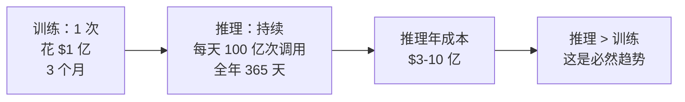

**关键洞察**：训练成本是"一次性"的，推理成本是"复利式"累积的。一个模型训练一次，但被调用几十亿次。所以即使单次推理成本只有训练成本的亿分之一，总量也会反超。

> **商业含义**：训练决定了"能不能做"，推理决定了"能不能赚钱"。一个推理成本太高的模型，即使再聪明，也无法商业化。

---

## 二、推理的两个核心指标：延迟与吞吐

### 2.1 两个截然不同的指标

| 指标 | 含义 | 用户视角 | 商业含义 |
|------|------|----------|----------|
| **延迟（Latency）** | 生成第一个 token 的时间（TTFT）+ 每个 token 的时间 | "响应快不快" | 交互式场景（聊天、搜索）的关键 |
| **吞吐（Throughput）** | 单位时间能处理多少 token | 用户感知弱 | 批处理场景（翻译、摘要）的关键 |

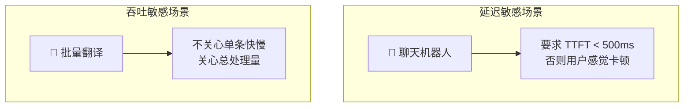

**关键矛盾**：延迟和吞吐往往**不可兼得**。

### 2.2 吞吐-延迟权衡

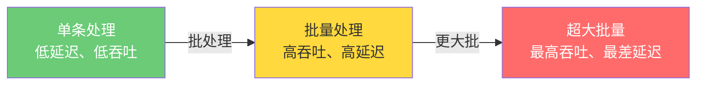

**类比**：
- 延迟优先 = **出租车**——随叫随走，但一次只拉一个人，效率低
- 吞吐优先 = **公交车**——等满才发车，单客慢但总运送量大
- 极端吞吐 = **货运列车**——装满才走，单件极慢但总量最大

**商业决策**：根据场景选择。聊天用出租车模式（小批量、低延迟），翻译用公交车模式（大批量、高吞吐）。

---

## 三、KV Cache：推理的内存核心

### 3.1 什么是 KV Cache？

Week 6 已经介绍过 KV Cache。本周从**推理工程**角度深入。

LLM 生成文本时是**逐 token 生成**的。每生成一个新 token，需要让它"看到"前面所有的 token（通过 Attention）。如果不缓存，每生成一个 token 都要重新计算前面所有 token 的 Key 和 Value——计算量爆炸。

**KV Cache** = 把前面所有 token 的 Key 和 Value **存起来**，生成新 token 时直接读取，不重算。

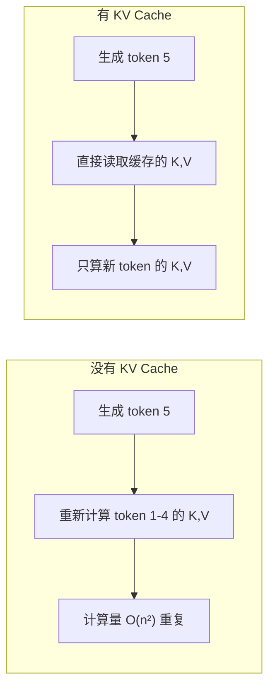

### 3.2 KV Cache 的内存占用

KV Cache 的大小 = **2（K和V）× 层数 × 隐藏维度 × 上下文长度 × 精度字节数**

以 70B 模型、128K 上下文、BF16 为例：

| 组成 | 计算 | 大小 |
|------|------|------|
| 层数 | 80 层 | — |
| 隐藏维度 | 8192 | — |
| 上下文 | 128K = 131,072 | — |
| 单条 KV Cache | 2 × 80 × 8192 × 131072 × 2 bytes | **≈ 343 GB** |

> **关键发现**：一个 70B 模型（参数本身约 140GB），在 128K 上下文下，**KV Cache 反而比模型参数还大**！这就是为什么长上下文推理极其昂贵。

### 3.3 KV Cache 的商业影响

| 因素 | 影响 |
|------|------|
| 上下文越长 | KV Cache 线性增长 → 单请求内存越大 → 同时能服务的用户越少 |
| 批处理越大 | 每个请求都占一份 KV Cache → 总内存爆炸 |
| 多用户并发 | 每用户独立 KV Cache → 内存是并发的硬瓶颈 |

**这就是 Week 7 讲的"API 按 token 收费"的物理根源**——长上下文不只是计算贵（O(n²)），内存（KV Cache）也贵，且内存决定了你能同时服务多少用户。

---

## 四、推理优化技术全景

### 4.1 优化技术的三个方向

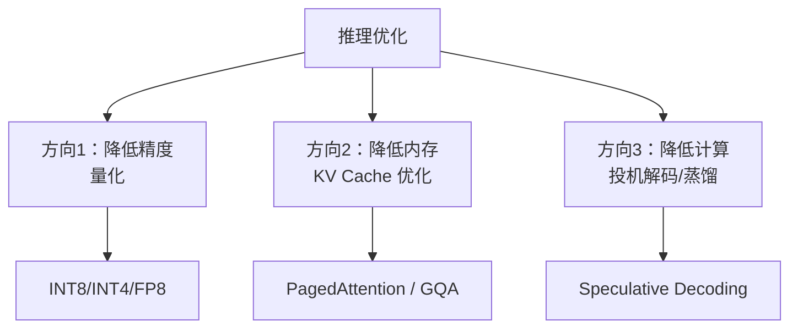

### 4.2 量化（Quantization）：用精度换吞吐

**核心思想**：把模型参数从高精度（BF16/FP32）压缩到低精度（INT8/INT4/FP8），内存减半、速度翻倍，代价是轻微精度损失。

| 精度 | 参数字节数 | 相对内存 | 相对速度 | 精度损失 | 适用 |
|------|-----------|---------|---------|---------|------|
| FP32 | 4 bytes | 100% | 1× | 0% | 研究、基准 |
| BF16 | 2 bytes | 50% | 2× | <1% | 训练、高质量推理 |
| INT8 | 1 byte | 25% | 4× | 1-3% | 主流推理 |
| INT4 | 0.5 byte | 12.5% | 6-8× | 3-8% | 成本敏感推理 |
| FP8 | 1 byte | 25% | 4× | <1% | Blackwell 新架构 |

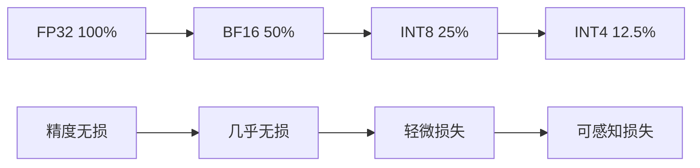

**量化的帕累托前沿**：

> **帕累托前沿** = 在"精度损失"和"成本节省"之间，不存在"既更便宜又更精确"的方案的最优边界。

当前实践共识：
- **INT8 是甜点区**——精度损失 <3%，用户几乎感知不到，但内存省 4 倍
- **INT4 是极限**——精度损失开始可感知，但成本省 8 倍，适合对成本极度敏感的场景
- **FP8 是新趋势**——Blackwell 架构原生支持，有望兼顾 INT8 的速度和 BF16 的精度

### 4.3 量化时机：PTQ vs QAT

| 方式 | 全称 | 时机 | 优点 | 缺点 |
|------|------|------|------|------|
| **PTQ** | Post-Training Quantization | 训练后直接量化 | 简单、快、无需重训 | 低精度（INT4）下精度损失大 |
| **QAT** | Quantization-Aware Training | 训练时就模拟量化 | 低精度下精度更好 | 需要重训，成本高 |

**类比**：
- PTQ = 拍完照再压缩 JPEG——快但画质损失不可控
- QAT = 拍照时就按 JPEG 压缩规则调整——慢但画质最优

### 4.4 PagedAttention：解决 KV Cache 内存碎片

**问题**：不同请求的上下文长度不同，KV Cache 大小不一。连续内存分配会导致**碎片化**——像停车场里大小不一的车，总有空位但停不进去。

**PagedAttention（vLLM 的核心创新）**：借鉴操作系统的**虚拟内存分页**机制，把 KV Cache 切成固定大小的"页"，按需分配，消除碎片。

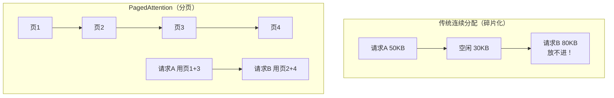

**效果**：vLLM 相比传统框架，**吞吐量提升 2-4 倍**——几乎免费的性能提升，纯软件优化。

### 4.5 GQA：缩小 KV Cache 的架构级优化

Week 6 已介绍 GQA（分组查询注意力）。从推理角度回顾：

| 架构 | KV Cache 大小 | 代表模型 |
|------|---------------|----------|
| MHA（多头注意力） | 100%（基准） | GPT-3、早期 Llama |
| MQA（多查询注意力） | 1/num_heads（极端） | 早期实验 |
| **GQA（分组查询）** | **1/4 - 1/8** | **Llama 3、现代模型** |

**GQA 是在模型架构层面就缩小了 KV Cache**，不需要量化，精度损失极小。这就是为什么现代模型几乎都用 GQA——**架构设计本身就为推理优化考虑**。

### 4.6 Speculative Decoding：投机解码

**核心思想**：用一个小而快的"草稿模型"先生成几个 token，再用大模型一次性验证。如果草稿对了，省下大量计算；如果错了，只需重算少数 token。

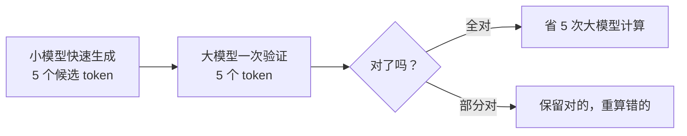

**类比**：写作文时先让实习生打草稿（快但糙），主编只审核修改（慢但精）。如果实习生写得不错，主编省力；如果不行，主编重写。

**效果**：在适合的场景下，延迟降低 2-3 倍，且**输出完全一致**（不损失精度）——这是罕见的"免费午餐"。

### 4.7 蒸馏（Distillation）：用大模型教小模型

**核心思想**：用一个大而强的"教师模型"指导训练一个小而快的"学生模型"，让学生逼近教师的能力。

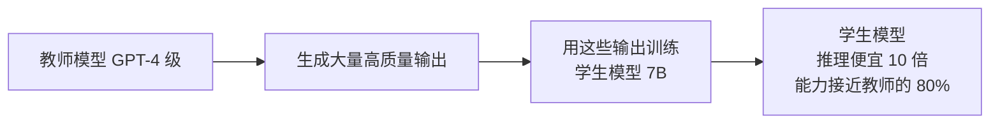

**类比**：大师傅带徒弟——徒弟虽然达不到师傅的全部功力，但学到了八成，而且徒弟干活快、要钱少。

**商业价值**：蒸馏让中小公司也能部署"接近大模型"的能力，但用小模型的成本。这也是为什么开源小模型（Llama 3 8B、Qwen 7B）能力不断提升——背后往往有大模型蒸馏的影子。

---

## 五、推理经济学：token 的成本结构

### 5.1 单次推理成本分解

一次 API 调用（输入 1000 token + 输出 500 token）的成本：

| 组成 | 占比 | 说明 |
|------|------|------|
| GPU 折旧/租赁 | 60-70% | 最大头，按 GPU·小时计 |
| 电费 | 15-20% | GPU 满载功耗 |
| 网络/存储 | 5-10% | 数据传输、KV Cache 存储 |
| 运维/软件 | 5-10% | 框架、监控、调度 |

### 5.2 token 经济学

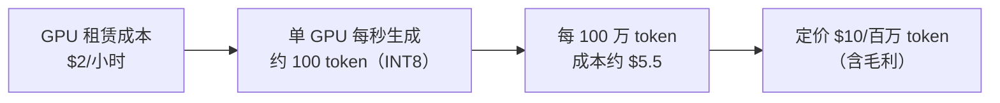

**当前（2024-2025）主流模型 API 定价**：

| 模型 | 输入价格（/百万 token） | 输出价格（/百万 token） |
|------|------------------------|------------------------|
| GPT-4o | $2.5 | $10 |
| Claude 3.5 Sonnet | $3 | $15 |
| GPT-4（旧） | $30 | $60 |
| Llama 3 70B（自部署） | ~$1（成本） | ~$1（成本） |

> **趋势观察**：2 年内价格下降约 10 倍。这正是 Week 4 讲的"推理成本降低扩大市场"的体现——价格越低，能用 AI 的场景越多。

### 5.3 推理成本为何决定商业化天花板

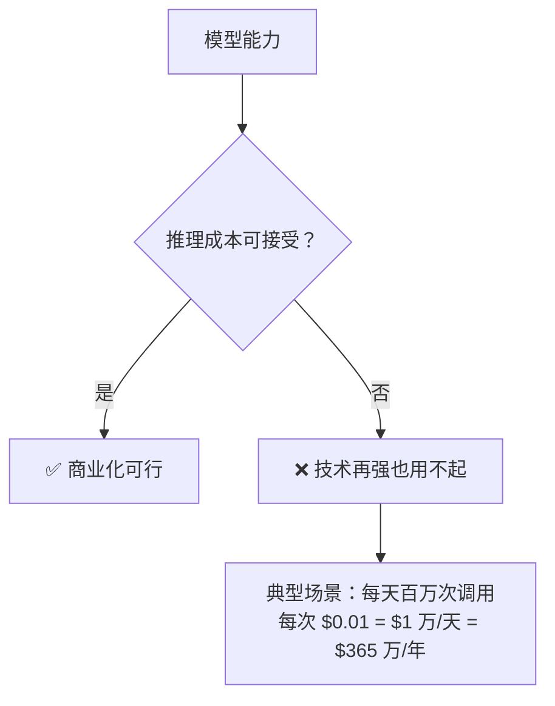

**典型算账**：
- 企业想做 AI 客服，每天 100 万次对话，每次平均 2000 token
- 用 GPT-4：$0.06/次 × 100 万 = **$6 万/天 = $2190 万/年**——多数企业承担不起
- 用 Llama 3 70B 自部署：$0.002/次 × 100 万 = **$2000/天 = $73 万/年**——可承受
- 用蒸馏小模型：$0.0005/次 × 100 万 = **$500/天 = $18 万/年**——非常划算

**这就是为什么推理优化技术（量化、蒸馏、PagedAttention）有巨大商业价值**——它们直接决定了哪些 AI 应用"用得起"。

---

## 六、推理基础设施：与训练的不同

### 6.1 推理集群 vs 训练集群

| 维度 | 训练集群 | 推理集群 |
|------|----------|----------|
| GPU 类型 | H100/B200（高精度、高带宽） | 可用 L40S/A10（性价比优先） |
| 互联要求 | 极高（NVLink+IB，万卡全互联） | 中等（张量并行 8 卡即可） |
| 利用率 | 波动（有训练间隙） | 高（24/7 持续服务） |
| 部署位置 | 集中（电费便宜、土地便宜的地方） | 分散（靠近用户，降低延迟） |
| 故障容忍 | Checkpoint 恢复 | 多副本负载均衡 |

### 6.2 推理的部署模式

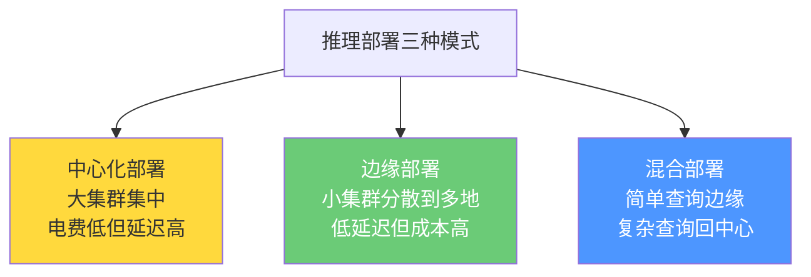

**商业决策**：
- 批处理场景（翻译、摘要）→ 中心化（电费便宜的地方，如冰岛、内蒙）
- 交互场景（聊天、搜索）→ 边缘（靠近用户的城市数据中心）
- 大厂通常混合部署——简单请求边缘处理，复杂请求回中心

### 6.3 推理框架生态

| 框架 | 开发者 | 特点 | 适用 |
|------|--------|------|------|
| **vLLM** | UC Berkeley | PagedAttention，吞吐王 | 高并发 API 服务 |
| **TensorRT-LLM** | NVIDIA | 极致优化，依赖 NVIDIA | NVIDIA GPU 生产环境 |
| **TGI** | HuggingFace | 易用，开源生态好 | 中小团队 |
| **llama.cpp** | 社区 | CPU/边缘可跑，量化好 | 个人、边缘设备 |
| **SGLang** | 社区 | 结构化生成优化 | Agent、工具调用场景 |

---

## 七、推理优化的帕累托前沿

### 7.1 精度-成本权衡全景

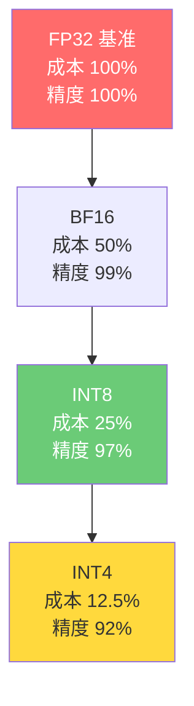

**当前实践共识的"甜点区"**：
- 交互式高质量服务 → INT8 + GQA + PagedAttention
- 成本敏感批处理 → INT4 + 蒸馏小模型
- 极致延迟 → 投机解码 + 小模型

### 7.2 组合优化的叠加效应

各项优化技术可以叠加，但不是简单相加：

| 优化 | 单项收益 | 与其他叠加 |
|------|---------|-----------|
| INT8 量化 | 4× 吞吐 | 与 GQA 叠加（独立维度） |
| GQA | KV Cache 缩 4-8× | 与量化叠加（独立维度） |
| PagedAttention | 2-4× 吞吐 | 与量化叠加（部分重叠） |
| 投机解码 | 2-3× 延迟改善 | 与量化叠加（独立维度） |
| 蒸馏小模型 | 10× 成本降低 | 与量化叠加（独立维度） |

**组合案例**：Llama 3 70B + INT8 + GQA + PagedAttention + 投机解码 ≈ 相比裸 BF16 基准，**吞吐提升 10-20 倍，延迟改善 3-5 倍**——这就是为什么同代模型的 API 价格能持续下降。

---

## 八、商业洞察：推理时代的赢家

### 8.1 产业链价值转移

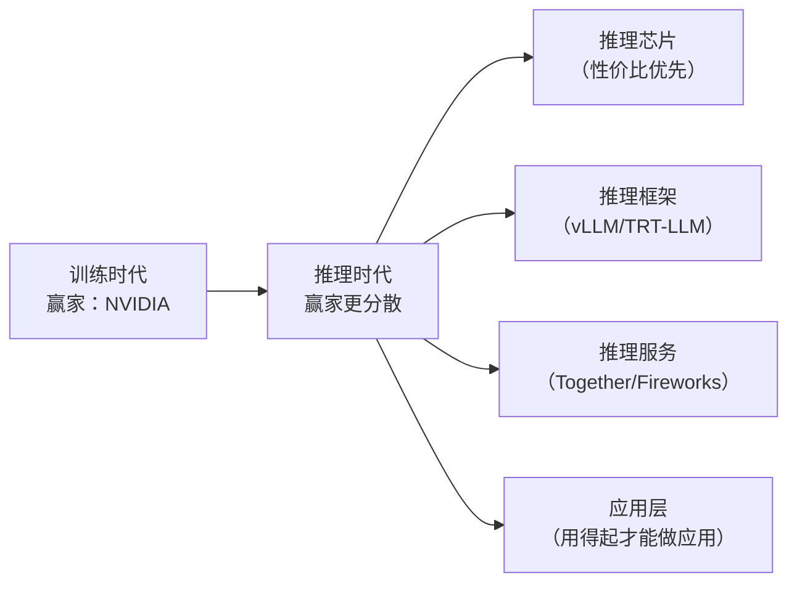

### 8.2 各环节投资逻辑

| 环节 | 代表 | 训练时代 | 推理时代 | 评级 |
|------|------|----------|----------|------|
| 高端 GPU | NVIDIA H/B 系列 | ⭐⭐⭐⭐⭐ | ⭐⭐⭐⭐ 仍核心，但份额受蚕食 |
| 推理专用芯片 | Groq、Cerebras、AMD | ⭐⭐ 边缘 | ⭐⭐⭐⭐ 性价比优势放大 |
| 推理框架 | vLLM、TensorRT-LLM | — | ⭐⭐⭐ 重要但不直接赚钱 |
| 推理云服务 | Together AI、Fireworks、CoreWeave | ⭐⭐⭐ | ⭐⭐⭐⭐⭐ 需求爆发 |
| 量化工具链 | 各类量化服务 | — | ⭐⭐⭐ 基础设施化 |
| 应用层 | 各类 AI SaaS | 受限成本 | ⭐⭐⭐⭐ 成本下降释放需求 |

### 8.3 关键商业判断

1. **推理时代，"性价比"开始压倒"绝对性能"**——这与 Week 5 讲的 Groq/Cerebras 机会窗口吻合
2. **推理云服务是增长最快的环节**——企业不想自建 GPU，租赁需求爆发
3. **量化/蒸馏技术让开源模型商业可行**——Llama 3 + INT8 自部署成本仅为 GPT-4 API 的 1/30
4. **应用层是最终受益者**——推理成本下降 10 倍，意味着 10 倍多的 AI 应用"用得起"
5. **NVIDIA 仍强势，但护城河从"训练必需"转向"推理优选"**——议价能力下降

---

## 九、本周小结

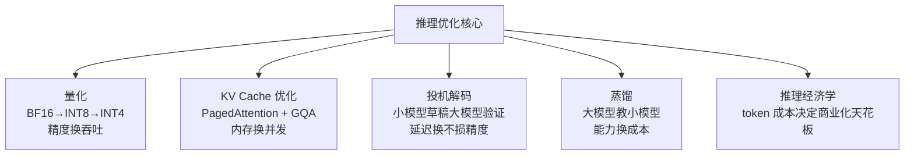

**一句话总结**：推理优化的本质是**在用户可感知的精度损失边界内，把单 token 成本压到最低**——这决定了 AI 能渗透到多少商业场景。

---

## 十、思考题

::: warning 🧠 本周推演题（完成后解锁 Week 10）

**题目 1：推理优化的组合决策**

已知条件（从讲义可推导）：
- INT8 量化让吞吐提升 4 倍，精度损失 <3%
- PagedAttention 让吞吐提升 2-4 倍，无精度损失
- 投机解码让延迟改善 2-3 倍，无精度损失
- 蒸馏小模型让成本降低 10 倍，但能力下降约 20%

问题：你要为一家电商公司部署 AI 客服，日均 100 万次对话，每次约 2000 token，要求响应延迟 < 1 秒。你会选择哪些优化技术的组合？为什么？哪些优化是你**不会**选的？

**题目 2：推理成本与商业化可行性**

已知条件：
- GPT-4 级 API 约 $0.06/次（2000 token）
- Llama 3 70B 自部署约 $0.002/次（含 GPU 折旧）
- 蒸馏小模型约 $0.0005/次

问题：一个 AI 客服场景，企业每天 100 万次调用，企业能接受的年成本上限是 $100 万。请判断：用 GPT-4 API、Llama 3 自部署、蒸馏小模型，分别是否可行？如果只能选一个，选哪个？如果企业要求"回答质量必须接近 GPT-4"，你的选择会变吗？

**题目 3：推理时代的赢家转移**

已知条件：
- 训练时代 NVIDIA 是绝对赢家（高端 GPU 必需）
- 推理时代"性价比"开始压倒"绝对性能"
- 推理云服务需求爆发（企业不自建 GPU）
- 应用层因成本下降而释放需求

问题：如果推理成本在未来 3 年再下降 10 倍，你认为产业链中哪一层受益最大？哪一层受损最大？请基于讲义逻辑说明理由。

:::
