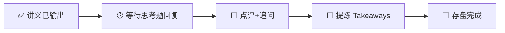

---
prev:
  text: '📖 讲义'
  link: '/week-10/lecture'
next:
  text: '✅ 认知存盘'
  link: '/week-10/takeaways'
---

# Week 10 · 互动记录

::: info 状态
🟡 等待思考题推演回复
:::

## 交互流程

## 思考题回顾

### 题目 1：容量规划的决策
> B 端 SaaS 只在工作日工作时间有流量，用 10.8 小时法则逐层定价，算周利用率、年成本与有效单价。

**你的回答**：（待填写）

**点评与补充**：（待填写）

---

### 题目 2：Serverless GPU 的适用边界
> 三个场景（AI 封面生成 / 实时口语陪练 / 200 个部门小模型），哪些能上 Serverless GPU？

**你的回答**：（待填写）

**点评与补充**：（待填写）

---

### 题目 3：云厂商的结构性优劣
> 推理需求爆发 + 单价下行 + 老卡转推理岗，四类玩家谁被放大谁被削弱？并尝试反驳"GPU 云必然集中"。

**你的回答**：（待填写）

**点评与补充**：（待填写）

---

## 追问与延伸讨论

（互动过程中产生的追问将记录在此）
