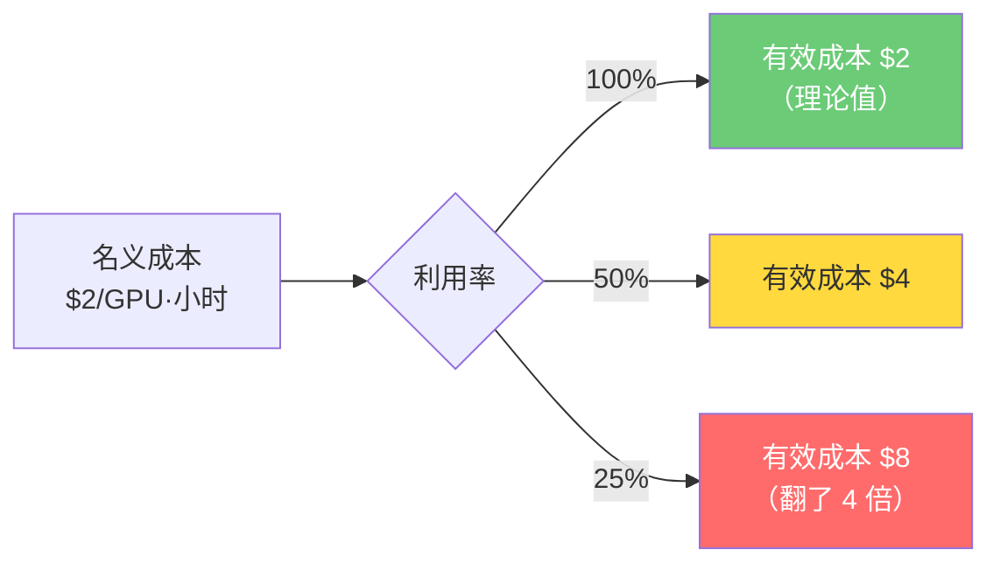
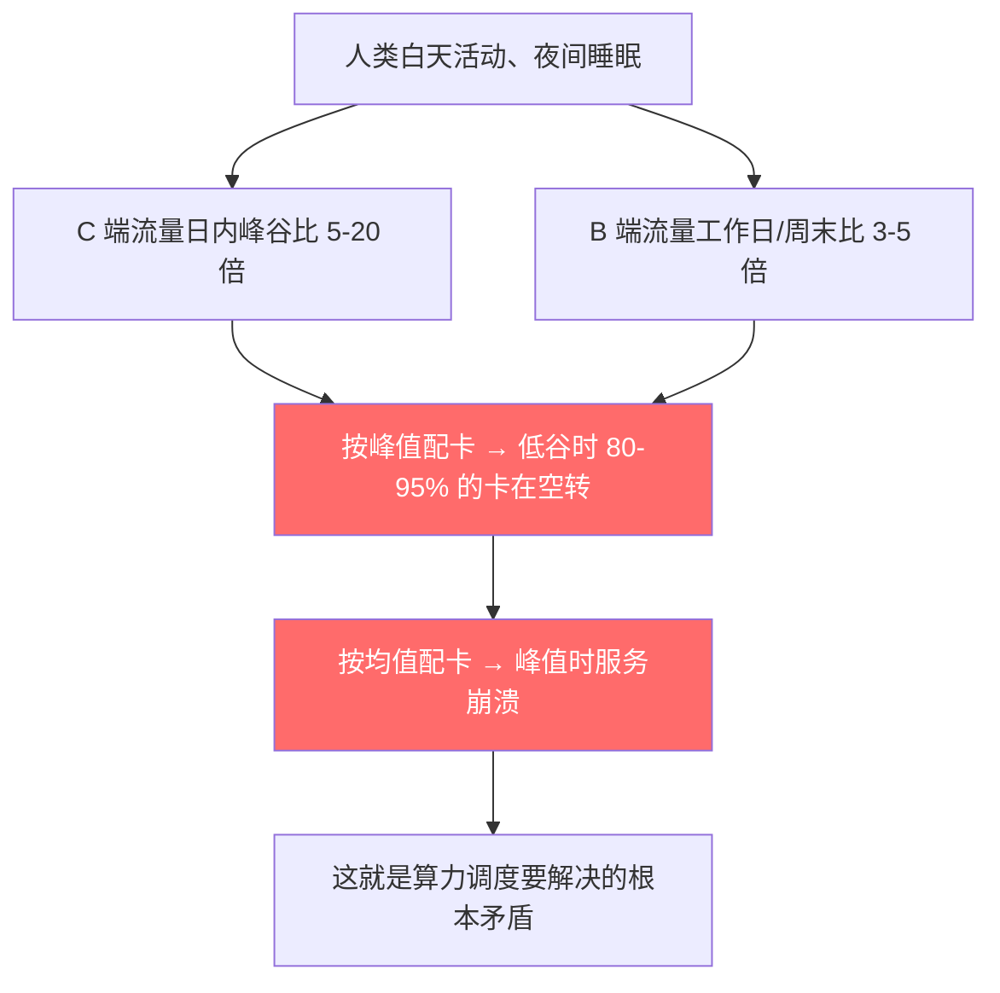
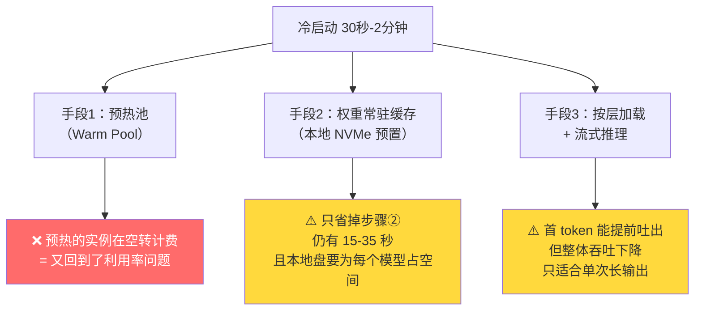
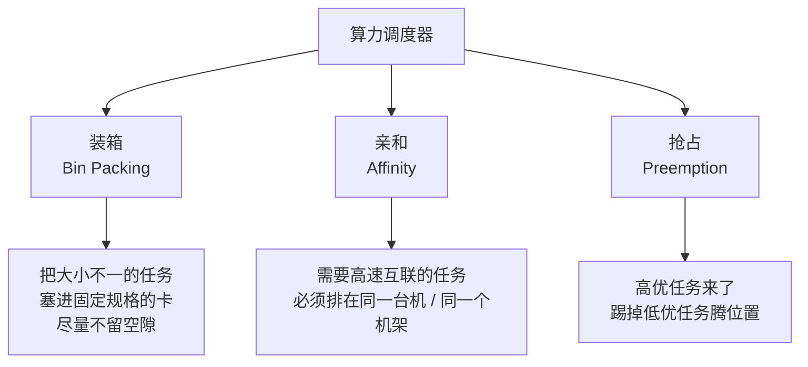
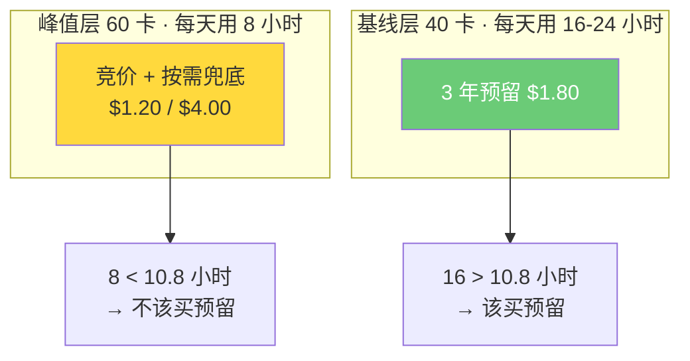
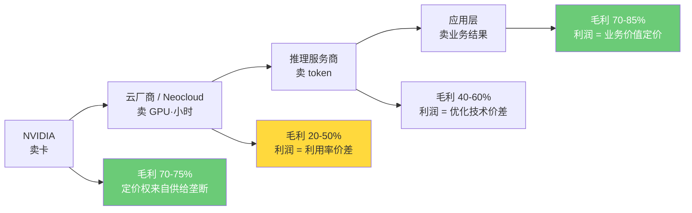
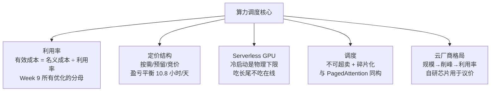

---
prev:
  text: 'Week 9 · 推理优化'
  link: '/week-09/lecture'
next:
  text: '💬 互动记录'
  link: '/week-10/interaction'
---

# Week 10 · 云计算与算力调度

::: tip 本周定位
Week 9 把**单次推理**的成本压到了极致——量化、KV Cache 优化、投机解码，一路把每百万 token 从 $5.5 砍到 $1。但那笔账藏着一个没说出口的假设：**GPU 一直在满负荷运转**。

现实中它不是。真实业务的流量有峰有谷，而 GPU 不会因为没人用就停止计费。**利用率（Utilization）是悬在所有推理成本之上的一个乘数**——Week 9 算出的所有数字，都要再除以它。

本周讲的就是这个乘数：算力该买还是该租、空闲的卡怎么办、能不能做到"不用不花钱"，以及这件事如何决定了云厂商之间的胜负。
:::

---

## 一、算力的三种获取方式

### 1.1 自建 / 长租 / 按需

| 维度 | 自建（Self-hosted） | 长期预留（Reserved） | 按需（On-Demand） |
|------|---------------------|---------------------|-------------------|
| **成本性质** | 资本开支（CapEx） | 承诺型运营开支 | 纯运营开支（OpEx） |
| **前期投入** | 极大（$3-4 万/卡 + 机房） | 零 | 零 |
| **单位成本** | 最低（折旧摊完后几乎只剩电费） | 中（基准价 -35% 到 -55%） | 最高（基准价） |
| **弹性** | 无——卡买了就在那 | 无——合同期内必须付钱 | 完全弹性 |
| **技术过时风险** | 全部自担（3 年一代） | 部分自担 | 零 |
| **交付周期** | 6-18 个月（建机房、等货） | 数天 | 数分钟 |
| **适合谁** | 负载稳定且规模巨大 | 负载有稳定基线 | 负载突发、不可预测 |

**类比**——这三条路就是**买车 / 长租 / 打车**：

- **买车**：每公里成本最低，但首付巨大，车停在车位里也在折旧，三年后还要操心二手残值
- **长租**：月付固定，省掉首付和残值风险，但合同期内你不开也得付
- **打车**：完全按需，一分钟不用一分钱不花，但每公里单价是买车的三四倍

没有哪一种绝对更好。**决定因素只有一个：你每天开几个小时。**

### 1.2 这个类比里最关键的那句话

"每天开几个小时"翻译成算力领域，就是**利用率**。

而大多数算力成本的误判，都源于一件事：**算成本时用的是卡的单价，但付钱时付的是卡的时间**。

---

## 二、利用率：被隐藏的成本乘数

### 2.1 一个让所有账都要重算的公式

```
有效单位成本 = 名义单位成本 ÷ 利用率
```



**这意味着 Week 9 的所有优化都可能被一个数字抵消**：你费尽力气用 INT8 + PagedAttention 把吞吐提了 4 倍，结果利用率只有 25%，净收益归零。

> **商业含义**：在 GPU 这件事上，**运营效率和技术优化处在同一个量级**。一个利用率 80% 的平庸团队，成本结构会优于一个利用率 20% 的技术高手团队。

### 2.2 真实利用率有多低

| 场景 | 典型 GPU 利用率 | 原因 |
|------|----------------|------|
| 企业自建推理集群 | 20-40% | 按峰值配卡，大部分时间在等流量 |
| 企业自建训练集群 | 40-60% | 任务排队间隙、调试占用、数据准备阶段卡空转 |
| 超大规模云（Hyperscaler） | 60-70% | 多租户削峰填谷，客户之间错峰 |
| 特化推理云（如 Together、Fireworks） | 70-85% | 单一负载类型 + 持续批处理（continuous batching） |

> **这张表本身就是一条投资逻辑**：云厂商相对自建的核心优势不是"卡更便宜"（同样是从 NVIDIA 买的），而是**它能把你的峰谷和别人的峰谷叠在一起互相填平**。

### 2.3 峰谷比的物理来源

GPU 利用率低，根子不在技术，在**人类作息**：



**这是个无法用技术消灭、只能用调度缓解的结构性问题。** 它和电网的调峰问题（Week 1）在数学上完全同构——都是"不可储存的产能 + 波动的需求"。区别在于，电网可以用抽水蓄能把电"存起来"，**算力不行：一张卡这一秒没人用，这一秒的算力就永久消失了**。

### 2.4 回到 Week 9 那笔账

Week 9 算出电商 AI 客服用 Llama 3 70B 自部署，年成本 **$73 万**。这个数字隐含了"卡 100% 跑满"。

现在给它一个真实的负载曲线：

| 时段 | 时长 | 所需 GPU |
|------|------|---------|
| 高峰（白天 + 晚间促销） | 8 小时 | 100 卡 |
| 平峰 | 8 小时 | 40 卡 |
| 低谷（凌晨） | 8 小时 | 5 卡 |

峰谷比 **20:1**。按峰值配 100 卡，则：

- 实际需要的算力：(100 + 40 + 5) × 8 = **1,160 GPU·小时/天**
- 实际买单的算力：100 × 24 = **2,400 GPU·小时/天**
- **利用率 = 1160 / 2400 = 48.3%**

**真实年成本 = $73 万 ÷ 0.483 ≈ $151 万**——**超出 $100 万预算 51%，Week 9 选定的方案直接不成立。**

::: warning 这就是本周要解决的问题
Week 9 的技术优化把成本降到了预算内，运营现实又把它顶了出去。**第七节会把这 $151 万压回 $95 万**——靠的不是任何新的推理技术，纯靠定价结构和调度。
:::

---

## 三、云厂商的 AI 基础设施差异

### 3.1 四种玩家，四种结构性优势

| 维度 | AWS | Azure | GCP | Neocloud<br/>（CoreWeave / Lambda / Oracle OCI） |
|------|-----|-------|-----|------------------|
| **自研 AI 芯片** | Trainium（训练）<br/>Inferentia（推理） | Maia（起步最晚） | **TPU**（已到第六代，最成熟） | 无 |
| **互联方案** | EFA（自研，以太网路线） | InfiniBand（为 OpenAI 专建） | Jupiter 光路交换 | InfiniBand 裸金属 |
| **模型供给** | Bedrock 多方聚合（含 Anthropic） | **OpenAI 深度独家绑定** | 自研 Gemini 全栈 | 无，纯卖算力 |
| **结构性优势** | 规模最大、全栈最全，客户数据已在站内，迁移成本高 | 独家拿到最强模型的供给，直接变成企业销售弹药 | **垂直整合最深**：芯片、框架（JAX/XLA）、模型全自研，不向 NVIDIA 交税 | 单位成本最低、交付最快、无历史包袱 |
| **结构性弱点** | 自研芯片生态弱，开发者不买账 | 对单一伙伴依赖过重，伙伴关系一变即失重 | 企业市场份额低，TPU 生态封闭、租不到散卡 | **没有粘性**——纯价格竞争，且高度依赖 NVIDIA 供货和债务融资 |

### 3.2 一个反直觉：自研芯片的真实目的不是替代 NVIDIA

表面看，AWS 做 Trainium、Google 做 TPU、微软做 Maia，是要把 NVIDIA 换掉。

但看实际份额：**即使是最成熟的 TPU，Google 自己的云上也仍然大量采购 NVIDIA**。2024-2025 年各家资本开支里，NVIDIA 采购额不降反增。

**真实目的是议价。**


**类比**——这就是**超市的自有品牌**。沃尔玛做自有品牌可乐，不是真要取代可口可乐（份额永远上不去），而是在和可口可乐谈进场费时有牌可打。**自有品牌只要存在，就在压低货架上所有品牌的价格。**

> 这与 Week 5 的判断吻合但更进一层：Week 5 说 ASIC 的机会在"性价比压倒绝对性能"的推理场景；本周补上另一半——**对云厂商来说，自研芯片的价值在它没被大规模使用时就已经兑现了**。

### 3.3 网络才是 GPU 云的隐形分水岭

Week 3 讲过 InfiniBand 和以太网的路线之争。那场技术之争在云市场上有一个非常具体的商业后果：

**GPU 云卖的不是 GPU，是"GPU 集群"。** 单卡性能是 NVIDIA 定的，各家都一样；**真正拉开差距的是把几千张卡连成一台机器的能力**。

| 能力层级 | 表现 | 能接什么单 |
|---------|------|-----------|
| 散卡 / 弱互联 | 几十卡以内可用 | 推理、微调、小规模训练 |
| InfiniBand 无阻塞组网 | 千卡级线性扩展 | 大模型预训练 |
| 万卡级可靠组网 + 故障自愈 | 支撑数月不中断的训练任务 | **frontier 模型训练** |

**最后一档只有极少数玩家做得到**，而它恰恰是单价最高、合同期最长、客户最黏的那一档。这解释了一个现象：同样卖 H100，有的厂商在打价格战，有的厂商在挑客户。**他们其实不在同一个市场里。**

---

## 四、GPU 云的定价结构

### 4.1 三种定价方式

以 H100 为例（示意价格，用于后续推演）：

| 定价方式 | 单价 | 相对折扣 | 约束 |
|---------|------|---------|------|
| **按需（On-Demand）** | $4.00/GPU·小时 | 基准 | 随用随停 |
| **1 年预留（Reserved）** | $2.60/GPU·小时 | −35% | 合同期内不用也付 |
| **3 年预留** | $1.80/GPU·小时 | −55% | 锁死 3 年，承担技术过时风险 |
| **竞价（Spot / Preemptible）** | $1.20/GPU·小时 | −70% | **可被云厂商随时回收** |

> Week 9 用的 $2/GPU·小时，大致对应 1-3 年预留的水平——那笔账默认了你已经签了长约。

### 4.2 预留 vs 按需的盈亏平衡点

这是容量规划里最该先算的一个数，而且可以口算：

- 预留一张卡：$1.80 × 24 = **$43.2/天**（无论用不用）
- 按需一张卡用 t 小时：**$4.00 × t**

令两者相等：$4.00t = 43.2 → **t = 10.8 小时/天 ≈ 45% 的时间**

::: tip 容量规划的第一性法则
**一层容量，如果一天用满 10.8 小时以上，就该买预留；低于这个数，就该用按需。**

注意这是**按容量分层**判断的，不是对整个集群做一次判断。下面第七节的分层模型就建立在这条法则上。
:::

### 4.3 竞价实例的本质

Spot 打七折，不是云厂商发善心，是一笔**风险交易**：


**云厂商把自己的利用率风险，打折卖给了你。**

**谁能接这个风险？**

| 负载类型 | 能用 Spot 吗 | 原因 |
|---------|-------------|------|
| 大模型预训练 | ✅ 能 | Week 8 讲过，训练本来就有 Checkpoint 机制，被打断可以从存档恢复 |
| 批量离线推理 | ✅ 能 | 任务可拆分、可重跑，晚几小时无所谓 |
| 模型微调 | ✅ 能 | 同训练 |
| **在线交互推理** | ❌ 不能 | 请求进行到一半实例被收回，用户直接看到报错 |
| 推理服务的**峰值溢出层** | ⚠️ 谨慎可用 | 需要按需实例做兜底，见 7.3 |

> **这是 Week 8 的容错设计在本周兑现成了真金白银**：Checkpoint 当初是为了对抗 GPU 故障，现在它顺带让训练任务拿到了 70% 的折扣。**可恢复性本身就是一种议价能力。**

---

## 五、Serverless GPU：经济模型成不成立

### 5.1 它承诺了什么

**Serverless（无服务器）** 在 CPU 世界已经成熟：你只上传代码，不管机器，**按请求的实际执行毫秒数计费，没有请求时成本为零**。

把这套搬到 GPU 上，正好击中本周的核心痛点——**利用率问题被彻底消灭了，因为空闲时间根本不计费**。

听起来是终局答案。但它卡在一个物理问题上。

### 5.2 冷启动：这是一个搬运问题，不是软件问题

**冷启动（Cold Start）** = 从"没有实例在跑"到"第一个请求能被处理"的时间。

把 Llama 3 70B（INT8 量化后约 **70 GB** 权重）拉起来需要几步：

| 阶段 | 内容 | 耗时（10 Gbps 网络） | 耗时（100 Gbps 网络） |
|------|------|---------------------|----------------------|
| ① 拉容器镜像 | 推理框架 + CUDA 运行时，约 5-10 GB | 5-10 秒 | 1 秒 |
| ② 对象存储 → 本地 NVMe | **70 GB 权重** | **56 秒** | 5.6 秒 |
| ③ 本地盘 → 显存 | 70 GB over PCIe（实测约 25 GB/s） | 2.8 秒 | 2.8 秒 |
| ④ 框架初始化 | CUDA context、算子编译、图 warmup | 10-30 秒 | 10-30 秒 |
| **合计** | | **约 1.5 分钟** | **约 20-40 秒** |

对比 CPU Serverless 的冷启动：**100-500 毫秒**。

**差了 100 到 1000 倍。根因只有一个：要搬运的数据量差了四个数量级——CPU 函数的代码包是几 MB，GPU 函数的模型权重是几十 GB。**

**类比**——CPU Serverless 像**便利店**：店员到岗就能卖货，开店只要开灯开门。GPU Serverless 像**开一家中央厨房**：厨师到岗没用，得先把几十吨食材从冷库运进来、把炉灶全部预热到工作温度。**人来得再快，备料的物理时间省不掉。**

> **关键判断**：冷启动不是"工程还没优化好"，它是**数据搬运的物理下限**。只要模型权重还是几十 GB 量级，这个时间就压不到毫秒级。任何声称解决了冷启动的方案，本质上都是在**避开搬运**，而不是在**加速搬运**。

### 5.3 三种缓解手段，以及各自的代价



**手段 1 值得单独说**：预热池是目前所有"Serverless GPU"产品的实际做法——保留 N 个常驻实例接住突发请求。但**一旦你保留了常驻实例，"不用不计费"的承诺就破了**，你只是把利用率问题从客户账单挪到了供应商账单上。

供应商能这么做的唯一理由是**多租户聚合**：它的预热池被成百上千个客户共享，单个客户的峰谷被别人填平了。**所以 Serverless GPU 的经济性不来自技术，来自规模**——这和 2.2 节那张利用率表指向的是同一件事。

### 5.4 经济模型成立的边界条件

| 负载特征 | 适合 Serverless GPU？ | 理由 |
|---------|---------------------|------|
| 间歇触发、单次任务重（批量文档处理、视频生成、离线微调） | ✅ **最适合** | 冷启动 1 分钟 vs 任务本身 30 分钟，占比 3%，可忽略 |
| 长尾模型服务（上百个小模型，每个日调用几十次） | ✅ **非常适合** | 常驻部署的话每个模型都要占一张卡，利用率不到 1% |
| 开发测试、实验环境 | ✅ 适合 | 用得零散，延迟不敏感 |
| 流量极度突发、容忍首请求慢（内部工具、审批流） | ⚠️ 勉强 | 需要接受偶发的秒级等待 |
| **在线交互式对话服务** | ❌ **不适合** | Week 9 要求 TTFT < 1 秒，而冷启动是它的 30-120 倍 |

::: tip 本节核心判断
**Serverless GPU 不是"替代常驻部署"，是"吃掉常驻部署的长尾"。**

它的目标市场不是那些 7×24 跑满的主力服务（那些本来利用率就高，不需要它），而是**那些利用率低到不配拥有一张专属 GPU 的零散负载**。

这是个非常大的市场——但它在在线推理的**隔壁**，不在它**里面**。
:::

---

## 六、算力调度：异构资源的分配问题

### 6.1 调度器要解决的三件事



### 6.2 GPU 调度与 CPU 调度的根本差异

| | CPU 调度 | GPU 调度 |
|---|---------|---------|
| **能否超卖** | ✅ 能。CPU 时间片可无限细分，10 个进程抢 1 核只是都变慢 | ❌ **不能**。显存是硬墙——装不下就是 OOM 崩溃，不是变慢 |
| **失败模式** | 优雅降级（变慢） | **硬失败（崩溃）** |
| **资源粒度** | 毫核级（0.001 核） | 整卡 / 固定分片 |
| **迁移成本** | 低，进程可热迁移 | **极高**，要重新加载几十 GB 权重 |

**这四条差异合起来，导致 GPU 调度必须保守**：CPU 集群可以跑到 90% 装载率靠超卖吸收波动，GPU 集群在 70% 就开始频繁调度失败。**"不能超卖"这一条，直接给 GPU 利用率设了天花板。**

### 6.3 碎片化：一个在两个尺度上重复出现的问题

::: tip 本周最值得记住的一处结构同构
Week 9 讲的 **PagedAttention**，解决的是**一张卡显存内部**的碎片：KV Cache 长度不一，连续分配会留下大量用不上的空隙。解法是**分页**——把显存切成固定大小的块，逻辑连续、物理离散。

本节讲的**集群调度碎片**，是**卡与卡之间**的碎片：一个任务要 3 张卡，集群里剩 20 张卡但分散在 10 台机器上每台 2 张，**总量够，但凑不出来**。

**同一个问题，在两个尺度上重复出现。而且解法的思路也一样：打破"必须物理连续"的假设。**
:::

| 尺度 | 碎片表现 | 解法 | 解法的本质 |
|------|---------|------|-----------|
| 卡内（显存） | KV Cache 空隙 | PagedAttention | 分页，逻辑连续物理离散 |
| 卡间（集群） | 凑不出整组卡 | 装箱算法 + 整理（defrag） | 任务重排，主动腾出连续资源 |
| 机架间（网络） | 卡够但互联不够快 | 拓扑感知调度 | 把通信密集的任务收拢 |

> **为什么值得专门指出**：当你发现同一个结构在不同尺度反复出现，说明它是这个领域的**基本约束**，而不是某个实现的缺陷。遇到新问题时，可以直接去上一个尺度找解法原型。

### 6.4 切分一张卡：三种共享方式

当任务比一整张卡小（小模型推理、开发环境），让它独占整卡就是巨大浪费。三种切法：

| 方式 | 机制 | 隔离性 | 适用 |
|------|------|-------|------|
| **MIG**（Multi-Instance GPU） | 硬件级切分，一张 A100/H100 最多切 7 份，各份独享显存和计算单元 | **强**（硬件隔离） | 生产多租户 |
| **时间片**（Time-Slicing） | 多个容器轮流用整卡 | **无**——互相抢显存，一个 OOM 全挂 | 开发测试 |
| **MPS**（Multi-Process Service） | 多进程同时用 SM，提高并发 | 弱（无显存隔离） | 同一团队的可信负载 |

**实践原则很直接：生产环境只用 MIG，其余两种出事只是时间问题。**

### 6.5 异构集群的木桶效应

当集群里混着 A100、H100、国产卡时，会遇到一个很硬的约束：

| 任务类型 | 能否跨型号混用 | 原因 |
|---------|--------------|------|
| **分布式训练**（数据并行） | ❌ 不能 | 每步都要 AllReduce 同步（Week 8），**最慢的卡决定全局速度**。用 H100 配 A100，等于把 H100 降速到 A100 |
| **推理服务** | ✅ 能 | 各副本独立处理各自的请求，互不等待。只需按算力给不同型号分配不同的流量权重 |

> **这条差异有直接的采购含义**：训练集群必须**同构、整批采购**，一旦选型就锁死数年；推理集群可以**逐步混布、新旧叠加**，老卡退居二线继续服务。
>
> 换句话说——**老一代 GPU 不会消失，它会从训练岗位调到推理岗位**。这也解释了为什么 A100 在 H100 上市多年后仍有稳定的租赁市场。

---

## 七、弹性伸缩：为什么 GPU 弹性比 CPU 难

### 7.1 一个不等式决定了弹性能不能用

弹性伸缩（Auto-scaling）能不能接住流量，取决于一个很朴素的比较：

```
扩容耗时   vs   流量从当前涨到峰值所需的时间
```

| 层级 | 扩容耗时 | 能接住什么 |
|------|---------|-----------|
| 已预热实例调流量权重 | 秒级 | 任何突发 |
| 冷启动一个新实例 | 30 秒 - 2 分钟（见 5.2） | 分钟级爬坡的流量 |
| 向云厂商申请新的 GPU 配额 | 小时 - 天级 | 只能应对计划内增长 |
| 自建扩容（买卡、上架） | 6-18 个月 | 年度规划 |

**大促开始后 1 分钟流量涨 10 倍，而你的扩容要 2 分钟——这时候弹性伸缩在数学上就是无效的。** 唯一的解法是**提前预热**，而提前预热就意味着提前付费。

> **这是 5.2 节冷启动问题的第二次出场**：它在 Serverless 那里限制了计费模型，在这里限制了弹性速度。**同一个物理约束，卡住了两个完全不同的商业承诺。**

### 7.2 分层容量模型

把 4.2 节的盈亏平衡法则（一天用满 10.8 小时以上就该买预留）按容量**分层**应用：



用 2.4 节的负载曲线（峰 100 卡 8h / 平 40 卡 8h / 谷 5 卡 8h，年需求 **423,400 GPU·小时**）算四个方案：

| 方案 | 构成 | 年成本 | **有效单价**<br/>（每有效 GPU·小时） |
|------|------|-------|-------------------|
| **A 按峰值全预留** | 100 卡 × 24h × 365 × $1.80 | $1,576,800 | **$3.72** |
| **B 全按需** | 423,400 × $4.00 | $1,693,600 | **$4.00** |
| **C 分层（预留+按需）** | 预留 40 卡 $630,720<br/>+ 按需 60 卡×8h $700,800 | $1,331,520 | **$3.14** |
| **D 分层 + 峰值用竞价** | 预留 40 卡 $630,720<br/>+ 峰值层 70% 竞价/30% 按需 $357,408 | **$988,128** | **$2.33** |

### 7.3 两个必须注意的结论

**① 全按需（方案 B）反而最贵——弹性不是免费的。**

方案 B 把利用率做到了 100%（一分钟都没浪费），却是四个方案里最贵的。因为**按需的单价溢价（2.2 倍）超过了它省下的空闲（2.1 倍）**。

::: warning 这是本周最容易踩的反直觉
**"消除浪费"和"降低成本"不是一回事。** 为了把利用率从 48% 提到 100%，你支付了 122% 的单价溢价——净亏。

优化利用率只在**单价不变**时才等价于降成本。一旦提升利用率要靠切换到更贵的计费方式，就必须重新算总账。
:::

**② 方案 D 把有效单价从 $3.72 压到 $2.33，降幅 37%。**

折回 Week 9 那笔账：

```
$151 万 × (1 − 37%) ≈ $95 万
```

**重新落回 $100 万预算内，方案成立。**

而这 37% 的降幅里，**没有用到任何一项新的推理技术**——纯粹来自定价结构的选择和负载的分层。

> **这正是本周与 Week 9 的分工**：Week 9 降低的是**每 token 要花多少算力**，Week 10 降低的是**每份算力要花多少钱**。两者相乘，才是你真正付出的成本。**只做前者，优化成果会被利用率吃掉；只做后者，省的是一个本来就该更小的数。**

**方案 D 的隐含代价**（必须说清楚，否则是假账）：
- 需要一套**竞价实例被回收时自动切按需**的兜底机制，工程复杂度不低
- 要承担竞价拿不到卡的风险（文中假设 70% 命中率，实际随市场波动）
- 3 年预留锁死了 40 卡的技术代次——如果两年后出了性价比高 3 倍的新卡，这部分是沉没成本

---

## 八、商业洞察：算力调度层的价值捕获

### 8.1 价值链上谁赚什么钱



**中间两层的毛利最薄，而且性质完全不同**：

- **云厂商赚的是"利用率价差"**——按 70% 利用率的成本买卡，按客户 40% 的利用率收钱，差额就是利润。这是**运营效率的钱**。
- **推理服务商赚的是"优化技术价差"**（Week 9 那套栈）——同样一张卡，它能榨出 5 倍的 token。这是**技术的钱**。

> **一个推论**：这两层在互相侵蚀。云厂商会往上做推理优化（自己卖 token），推理服务商会往下做自建集群（自己管利用率）。**中间层的边界不稳定，长期会合并**。

### 8.2 Neocloud 的脆弱性

CoreWeave 这类纯 GPU 云在 2023-2025 年高速增长，但它的商业模型有一处结构性风险，值得单独拆：

| 环节 | 情况 | 风险 |
|------|------|------|
| 上游 | 从 NVIDIA 买卡，无议价权（没有自研芯片这张牌，见 3.2） | 成本端被捏住 |
| 融资 | 大量以 **GPU 作抵押**的债务融资 | GPU 残值下跌 → 抵押品缩水 → 融资成本上升 |
| 下游 | 客户高度集中于少数几家 AI 公司 | 单一客户流失即重创 |
| 护城河 | 价格和交付速度 | **可被复制**——超大规模云补齐产能后优势消失 |

**最要命的是中间那条**：这个模式**押注 GPU 残值保持坚挺**。而 Week 9 的结论（推理成本持续下降、性价比压倒绝对性能）恰恰指向新卡会快速贬值老卡。**一旦 GPU 残值下行，抵押融资和低价竞争会同时反噬。**

> 这不代表 neocloud 必然失败——6.5 节说过老卡会转岗到推理，残值有底。但**它的商业模型对 GPU 残值高度敏感**，这是分析它时必须盯住的单一变量。

### 8.3 各环节投资逻辑

| 环节 | 代表 | 核心竞争力 | 评级 | 关键风险 |
|------|------|-----------|------|---------|
| 超大规模云 | AWS / Azure / GCP | 多租户削峰 + 全栈绑定 | ⭐⭐⭐⭐⭐ | 资本开支吞噬自由现金流 |
| Neocloud | CoreWeave / Lambda | 单位成本 + 交付速度 | ⭐⭐⭐ | **GPU 残值 + 客户集中度** |
| 云厂商自研芯片 | TPU / Trainium | 议价筹码（非替代） | ⭐⭐⭐⭐ | 生态建设周期极长 |
| 调度 / 编排软件 | Kubernetes + GPU Operator、Ray、Slurm | 决定利用率天花板 | ⭐⭐ | **重要但不直接赚钱** |
| Serverless GPU | Modal / Replicate / 各云的 Serverless 推理 | 聚合长尾负载 | ⭐⭐⭐ | 在线推理市场进不去（5.4） |
| 算力交易 / 转售 | 各类 GPU 市场 | 撮合供需错配 | ⭐⭐ | 纯价差模式，供需平衡后消失 |

> **注意"调度软件"这一栏**：它和 Week 9 的"推理框架"（vLLM / TensorRT-LLM，同样是 ⭐⭐⭐ "重要但不直接赚钱"）是**同一种位置**——**处在价值链的关键节点，决定了谁能赚钱，但自己很难收费**。这类环节通常走向开源，由上下游巨头出钱维护。**技术重要性和价值捕获能力是两件事。**

### 8.4 五条关键判断

1. **利用率是 GPU 云唯一重要的指标，而规模是达成高利用率的前提**——多租户削峰需要足够多、足够不同的客户。这意味着 **GPU 云必然走向集中**，中小玩家在成本曲线上追不上。

2. **自研芯片的 ROI 在采购合同上，不在芯片上**——不需要真的替代 NVIDIA，只需要有能力不买它（3.2）。

3. **Serverless GPU 会先吃掉批处理和长尾模型，而不是在线推理**——冷启动是物理下限，不是工程债（5.2、5.4）。

4. **算力正在从"资源"变成"期货"**——预留、竞价、转售、按残值抵押融资，这些都是金融工具的形态。**当一种生产要素出现期限结构和风险定价，它就开始金融化了**。电力市场走过完全一样的路（Week 1）。

5. **老 GPU 不会消失，会从训练岗位转到推理岗位**（6.5）——这给 GPU 残值托了底，也意味着推理市场的供给会持续膨胀，**推理单价的下行压力是长期的**。

---

## 九、本周小结



**一句话总结**：Week 9 解决的是**"每个 token 要花多少算力"**，Week 10 解决的是**"每份算力要花多少钱"**——两者相乘才是真实成本，而**第二项的优化空间（37%）完全不依赖任何模型技术**。

**与前序周次的三处咬合**：

| 本周内容 | 咬合点 |
|---------|-------|
| 峰谷调度的根本矛盾 | **Week 1 电网调峰**——不可储存的产能 + 波动的需求，数学同构（且算力比电更糟：无法蓄能） |
| 集群互联决定能接什么单 | **Week 3 InfiniBand vs 以太网**——技术路线之争的商业后果 |
| 竞价实例能用于训练 | **Week 8 Checkpoint**——当初为容错做的设计，现在变成了 70% 的折扣 |
| 集群碎片 vs 显存碎片 | **Week 9 PagedAttention**——同一个问题的两个尺度 |

---

## 十、思考题

::: warning 🧠 本周推演题（完成后解锁 Week 11）

**题目 1：容量规划的决策（计算题，讲义内可完整推导）**

已知条件（全部来自讲义 4.1 和 7.2）：
- 按需 $4.00 / 1年预留 $2.60 / 3年预留 $1.80 / 竞价 $1.20（单位：GPU·小时）
- 预留 vs 按需的盈亏平衡点：一天用满 **10.8 小时**

现在换一个负载曲线——某 B 端 SaaS 的 AI 功能，**只在工作日的工作时间**有流量：

| 时段 | 覆盖时间 | 所需 GPU |
|------|---------|---------|
| 工作日 9:00-19:00 | 每周 5 天 × 10 小时 | 60 卡 |
| 工作日其余时间 | 每周 5 天 × 14 小时 | 5 卡 |
| 周末 | 每周 2 天 × 24 小时 | 5 卡 |

请回答：
1. 这套负载的**周利用率**是多少？（按峰值 60 卡配置计算）
2. 对"60 卡"这一层和"5 卡"这一层，**分别**该用哪种定价方式？用 10.8 小时法则逐层判断，注意时间口径要换算成"日均"
3. 算出你的方案的**年成本**和**有效单价**，并与"按峰值全部 3 年预留"对比
4. 这个负载和讲义里的电商客服（峰谷比 20:1、全年无休）相比，**哪一个更适合用 Serverless GPU？为什么？**

---

**题目 2：Serverless GPU 的适用边界（判断题，考 5.2-5.4 的推理链）**

下面三个业务场景，**都想上 Serverless GPU 来省钱**。请逐个判断是否可行，并说明判断依据：

- **场景 A**：短视频平台的 AI 封面生成。用户上传视频后触发，单次生成耗时约 40 秒，日均 3 万次，流量集中在晚 8-11 点。用户上传后可以等，不要求实时。
- **场景 B**：在线教育的实时口语陪练。学生说完一句，AI 要在 800 毫秒内开口回应。日活 5 万，上课时间集中在晚上和周末。
- **场景 C**：某公司内部有 **200 个**微调过的小模型（每个部门一个，各自处理本部门文档），每个模型日均被调用 20-50 次，分散在全天。

要求：
1. 对每个场景给出可行 / 不可行的判断，并引用讲义里的**具体数字**作为依据（不要只说"延迟高"）
2. 对判断为"不可行"的场景，给出替代方案
3. 三个场景里有一个是 Serverless GPU 的**最佳适用场景**，指出是哪个，并说明它为什么比另外两个更合适

---

**题目 3：云厂商的结构性优劣（开放推演，基于 3.1 和 8.2）**

已知讲义 3.1 的四方对比和 8.2 对 Neocloud 脆弱性的拆解。

假设未来 3 年发生以下三件事（这三条都是 Week 9 和本周讲义推出的趋势，不是新信息）：
- 推理需求继续爆发，但**训练需求增速放缓**（frontier 模型数量有限，而推理随应用铺开）
- 推理单价持续下行（Week 9 §8.3 + 本周 8.4 第 5 条）
- 老一代 GPU 大量转入推理市场（本周 6.5）

请推演：
1. **AWS / Azure / GCP / Neocloud 四类玩家，谁的结构性优势被放大？谁的被削弱？** 对每一家给出一句话的核心理由
2. 8.2 指出 Neocloud 的模式**对 GPU 残值高度敏感**。上述第三条趋势（老卡转推理岗）对 GPU 残值是**利好还是利空**？注意这里有两个方向相反的作用力，请把它们都找出来再下结论
3. 本周 8.4 第 1 条判断"GPU 云必然走向集中"。请你**尝试反驳它**——在什么条件下，中小 GPU 云反而能活得很好？（提示：回看 2.2 节"多租户削峰"成立的前提是什么，以及 5.4 节哪一类负载的利用率问题是用别的方式解决的）

> 💡 第 3 小问是本周难度最高的一题。它要求的不是记住结论，而是**找出结论成立的隐含前提，再去攻击那个前提**。

:::
